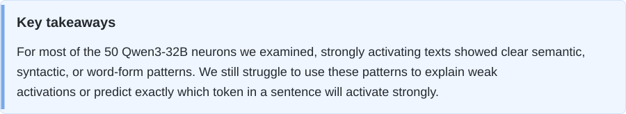

<p align="center">
  
</p>

<h1 align="center">Neuron Microscope</h1>

<p align="center">
  <strong>Investigating native neurons in language and vision models.</strong>
</p>

<p align="center">
  <a href="README_zh.md">中文</a> ·
  <a href="https://ruc-trustworthyai.github.io/Neuron-Microscope-Pages/reasoning-mix-100m-50/">Language model reports</a> ·
  <a href="vision/README.md">Vision model visualizations</a> ·
  <a href="https://ruc-trustworthyai.github.io/Neuron-Microscope-Pages/reasoning-mix-100m-50/L55_N11703/?compare=1">Open the Colorado case</a> ·
  <a href="https://ruc-trustworthyai.github.io/Neuron-Microscope-Pages/walkthrough/language/?lang=en">Language walkthrough</a> ·
  <a href="#use-neuron-microscope">Run the project</a>
</p>

<p align="center">
  <a href="https://ruc-trustworthyai.github.io/Neuron-Microscope-Pages/reasoning-mix-100m-50/"></a>
  <a href="vision/README.md"></a>
  <a href="https://ruc-trustworthyai.github.io/Neuron-Microscope-Pages/walkthrough/language/?lang=en"></a>
  <a href="#use-neuron-microscope"></a>
</p>

<a id="overview"></a>

Neuron Microscope reproduces and tests the neuron analyses behind Nick Cammarata's [*Neural Networks Are Already Clean*](https://already-clean.goodfire.com/). The project includes **Qwen3-32B language-model investigations** and **InceptionV1 feature visualization**.

| Model | What you can inspect | Entry point |
| --- | --- | --- |
| **Qwen3-32B** | Activation evidence, explanations, controlled tests, interventions and unresolved cases. | [Interactive neuron reports](https://ruc-trustworthyai.github.io/Neuron-Microscope-Pages/reasoning-mix-100m-50/) · [Investigation code](language/) |
| **InceptionV1 / Lucent Inception5h** | Five visualization objectives, natural-image examples, heatmaps and reference comparisons. | [Vision guide and examples](vision/README.md) · [Optimization code](vision/vision-repro/) |

**Data:** The current 50 reports use **Reasoning Mix 100M**. The [data guide](language/docs/data.md) describes the corpus sources, saved activation format and readers. Reports include selected contexts and measurements; full sampled texts and activation archives do not yet have a public download.

<picture>
  <source media="(max-width: 600px)" srcset="assets/key-takeaways-en-mobile.svg">
  
</picture>

[Key findings →](#key-findings)

## 📑 Contents <a id="contents"></a>

- [💬 Language model neuron reports](#language-model-neuron-reports)
- [🖼️ Vision model neuron visualizations](#vision-model-neuron-visualizations)
- [💡 Key findings](#key-findings)
- [🧪 The LLM investigation pipeline](#the-investigation-pipeline)
- [🔬 The vision investigation pipeline](#the-vision-investigation-pipeline)
- [⚖️ Evaluating the report evidence](#evaluating-the-report-evidence)
- [📦 Installation and usage](#installation-and-usage)
- [⏱️ Recorded runtime and cost](#recorded-runtime-and-cost)
- [🚧 Limitations](#limitations-and-future-work)
- [🚀 Future work](#future-work)
- [🤝 How to contribute](#how-to-contribute)
- [📖 Setup, data and report guides](#setup-data-and-report-guides)
- [📚 Related research from our group](#related-research-from-our-group)

## 💬 Language model neuron reports <a id="side-by-side-interactive-comparisons"></a> <a id="explore-the-evidence"></a> <a id="reports-and-walkthrough"></a><a id="live-demo"></a><a id="reproduction-results"></a> <a id="language-model-neuron-reports"></a>

### A side-by-side case: the Colorado neuron

Each neuron link opens the original report on the left and our reproduction on the right. Scroll either pane to move both; close the comparison to read the reproduction alone.

[Open the interactive comparison →](https://ruc-trustworthyai.github.io/Neuron-Microscope-Pages/reasoning-mix-100m-50/L55_N11703/?compare=1)

<p align="center">
  <a href="https://ruc-trustworthyai.github.io/Neuron-Microscope-Pages/reasoning-mix-100m-50/L55_N11703/?compare=1">
    
  </a>
</p>

Both reports identify a strong Colorado-related positive response, but they make different claims about what the neuron computes:

- **Published report:** the gate opens before a place-specific fill-in value, while the up projection carries signed place identity.
- **Our reproduction:** positive responses follow Colorado place and institution names across local-government, education, health, contact and news contexts. The negative account is limited to certain non-Colorado administrative contact and citation blocks.

In the Reasoning Mix 100M investigation, contact variants in `Contact block: {slot} End of contact.` reach **+188 to +352** for six Colorado institutions. Each value is the signed largest absolute response within the replacement span; all six peak on a space. Three out-of-state variants range from **-26.5 to +42.75**, while a generic clinic with a Colorado `720` number still reaches **+165**. These results support a Colorado-related response and leave the contributions of institution names, area codes and formatting to be separated. The report includes the full texts, attribution results, interventions and counterexamples.

### Browse all current reports

Explore **50 Qwen3-32B neurons on Reasoning Mix 100M**, with Blind and Search scores alongside each report.

[Open the report directory →](https://ruc-trustworthyai.github.io/Neuron-Microscope-Pages/reasoning-mix-100m-50/)

<p align="center">
  <a href="https://ruc-trustworthyai.github.io/Neuron-Microscope-Pages/reasoning-mix-100m-50/">
    
  </a>
</p>

Each row links to a full interactive report with activation evidence, exemplars, searches, clusters, effects, tests, criticism, an independent review and cost records. Across the 49 available scores in each column, **Blind has mean 0.864 and median 0.891; Search has mean 0.782 and median 0.808**. The directory shows these summaries in the column headings.

## 🖼️ Vision model neuron visualizations <a id="vision-neuron-visualizations"></a> <a id="vision-model-neuron-visualizations"></a>

The [vision module](vision/README.md) publishes all **12 layers and 5,804 InceptionV1 neurons** in five views: Positive, Path-guided +, Diversity, Negative and Path-guided − — **29,020 result groups and 46,432 optimized images**. Each neuron also has Top 16, Additional Examples and negative samples retrieved from 50,000 ImageNet training images, with receptive-field crops and activation heatmaps.

[Open interactive viewer →](https://vision-neuron-microscope.tart-olm-9383.chatgpt.site/?layer=mixed4c&neuron=477&compare=1)

<p align="center">
  
</p>

[Five-view comparisons →](vision/README.md#reproduction-results)

<table align="center">
  <thead>
    <tr><th scope="col">Source</th><th scope="col">Positive</th><th scope="col">Path-guided +</th><th scope="col">Diversity</th><th scope="col">Negative</th><th scope="col">Path-guided −</th></tr>
  </thead>
  <tbody>
    <tr>
      <th scope="row"><a href="https://already-clean.goodfire.com/microscope/inceptionv1.html?layer=mixed4c&amp;neuron=477">Nick / Goodfire</a></th>
      <td><a href="https://already-clean.goodfire.com/microscope/inceptionv1/fv/positive/mixed4c/477.png"></a></td>
      <td><a href="https://already-clean.goodfire.com/microscope/inceptionv1/fv/path_positive/mixed4c/477.png"></a></td>
      <td><a href="https://already-clean.goodfire.com/microscope/inceptionv1/fv/diversity/mixed4c/477.png"></a></td>
      <td><a href="https://already-clean.goodfire.com/microscope/inceptionv1/fv/negative/mixed4c/477.png"></a></td>
      <td><a href="https://already-clean.goodfire.com/microscope/inceptionv1/fv/path_negative/mixed4c/477.png"></a></td>
    </tr>
    <tr>
      <th scope="row">Ours</th>
      <td><a href="vision/docs/assets/mixed4c_477/positive.png"></a></td>
      <td><a href="vision/docs/assets/mixed4c_477/path_positive.png"></a></td>
      <td><a href="vision/docs/assets/mixed4c_477/diversity.png"></a></td>
      <td><a href="vision/docs/assets/mixed4c_477/negative.png"></a></td>
      <td><a href="vision/docs/assets/mixed4c_477/path_negative.png"></a></td>
    </tr>
  </tbody>
</table>

**mixed4c · 477**. Our results use configuration A, 224 × 224 inputs and 1,024 steps. Positive maximizes post-ReLU activation; Negative minimizes signed pre-ReLU activation. Diversity contains four images.

The model uses a pinned **Lucent Inception5h checkpoint**. The [method guide](vision/docs/methodology.md) explains the objectives, color priors and natural-example sampling. [Install and run](vision/README.md#quick-start) the vision module to reproduce these results.

## 💡 Key findings <a id="key-findings"></a> <a id="which-alreadyclean-claims-have-we-tested"></a> <a id="what-we-have-found-so-far"></a> <a id="observations-from-the-current-comparisons"></a>

### 1. Native neurons often have recognizable semantics at strong activations

Examples include [Colorado-related context](https://ruc-trustworthyai.github.io/Neuron-Microscope-Pages/reasoning-mix-100m-50/L55_N11703/?compare=0#exemplars), [firsthand experience expressed through “has to be seen / experienced”](https://ruc-trustworthyai.github.io/Neuron-Microscope-Pages/reasoning-mix-100m-50/L24_N17907/?compare=0#exemplars), and [the roles of mathematical letters](https://ruc-trustworthyai.github.io/Neuron-Microscope-Pages/reasoning-mix-100m-50/L50_N3507/?compare=0#exemplars). Their legibility resembles what we look for in SAE latents. These findings encourage us to devote more research effort to native neurons.

### 2. We cannot yet claim to fully understand neurons

[AlreadyClean](https://already-clean.goodfire.com/) estimates that roughly **90% of Qwen3-32B neuron poles have one main job**, with another approximately 7% having two related jobs. A footnote puts the share of non-arbitrary mixtures at about **97%** in some smaller, closely examined samples when judging strong activations. The essay also notes that these estimates depend on thresholds and on what counts as one job. Under our standard for explaining a neuron, this high estimate looks optimistic: **a good explanation should predict reasonably accurately where the neuron activates within a text.**

The [Colorado report](https://ruc-trustworthyai.github.io/Neuron-Microscope-Pages/reasoning-mix-100m-50/L55_N11703/?compare=0#exemplars) illustrates the coverage gap. Strong positive responses often follow Colorado-related information, but high activation occurs at only some positions and is not confined to a small fixed set of tokens. We can often anticipate that a sentence will contain a strong response, while still struggling to predict exactly which token will carry it or why other positions remain quiet.

### 3. Superposition remains a plausible explanation

**[Superposition](https://transformer-circuits.pub/2022/toy_model/index.html) may still be present in native representations**. AlreadyClean's V-shaped-feature example links different images through a shared shape. For many of the neurons we inspected, we have not found a comparable semantic pattern linking strong and weak responses.

For a concrete example, see [L55_N14892's Exemplars](https://ruc-trustworthyai.github.io/Neuron-Microscope-Pages/reasoning-mix-100m-50/L55_N14892/?compare=0#exemplars): an Ada attribute description reaches **+57**, while OpenSSH documentation reaches **-72.5**. In the same report's [Activation spectrum](https://ruc-trustworthyai.github.io/Neuron-Microscope-Pages/reasoning-mix-100m-50/L55_N14892/?compare=0#spectrum), a phosphatase glossary produces **+11.5625 on a space**, and a worked normal-distribution problem produces **+11 on `1`**. These weaker positives are about one fifth of the positive corpus maximum, yet their connection to the Ada/SQL-centered positive account remains unclear. In Spectrum, select **No visible cue** and the **8…16** activation bin to inspect these two examples.

[Leo Gao's response](https://www.lesswrong.com/posts/Dkh7pXKjoNWkkxQDz/neural-networks-are-not-already-clean) also argues that activation magnitudes can carry important information and expresses the view that ablating small neuron activations can materially harm performance. This makes the weaker responses important to investigate alongside the strongest examples. Testing this account requires feature decomposition and controlled interventions.

### 4. Neuron interpretations depend on the dataset

A useful contrast is [L49_N11562](https://ruc-trustworthyai.github.io/Neuron-Microscope-Pages/reasoning-mix-100m-50/L49_N11562/?compare=0#exemplars). In Reasoning Mix 100M, repeated book-catalog examples reach **-37 and -36** at newlines following their titles; the reference corpus minimum is **-11.8125**, with its strongest negative examples emphasizing configuration and code-declaration contexts. The larger negative tail brings catalog-title boundaries to the foreground of our account.

The reverse also occurs. For [L26_N8504](https://ruc-trustworthyai.github.io/Neuron-Microscope-Pages/reasoning-mix-100m-50/L26_N8504/?compare=0#distribution), our corpus spans **-4.15625 to +11.8125**, compared with **-7.5 to +21.25** in the reference. Both tails reach only about 55% of the reference magnitudes. Our account remains more fragmented, covering letter fragments and whitespace, while the reference centers on a specific alignment-whitespace pattern. Reduced exposure to strong examples may contribute to this difference.

Separate scans of **L51_N20229**, each at approximately 100M tokens, also expose different activation ranges:

<p align="center">
  <a href="assets/corpus-coverage.svg">
    
  </a>
</p>

These 50 neurons were selected from published reports, so this sample cannot establish the model-wide interpretability rate.

## 🧪 The LLM investigation pipeline <a id="the-investigation-pipeline"></a> <a id="the-three-stage-investigation-pipeline"></a> <a id="how-an-investigation-works"></a> <a id="workflow"></a> <a id="the-llm-investigation-pipeline"></a>

### Follow a recorded investigation

[Open the recorded language model walkthrough →](https://ruc-trustworthyai.github.io/Neuron-Microscope-Pages/walkthrough/language/?lang=en)

<p align="center">
  <a href="https://ruc-trustworthyai.github.io/Neuron-Microscope-Pages/walkthrough/language/?lang=en#loops">
    
  </a>
</p>

The walkthrough follows **L55_N11703 on Reasoning Mix 100M** from saved evidence to the final report. It presents the task prompts, excerpts of their inputs, structured responses, all three explanation-and-labeling versions, measured experiments and costs. The selected explanation is frozen before text construction and GPU experiments.

### Current runnable workflow

The code in `language/` orchestrates direct LLM API calls and target-model measurements. The LLM returns explanations, predictions and experimental inputs in defined JSON formats; Python selects evidence, executes measurements and assembles HTML. The LLMs that propose, refine and evaluate explanations do not receive AlreadyClean's explanations. When supplied, reference reports are added at publication for comparison. The configuration generator supplies the settings below.

1. **Sample evidence.** Allocate 500 positions equally across nonempty activation bins, selecting within each bin from the full saved corpus. Redistribute a bin's unused quota only when its corpus population is too small. The archive retains gate, up and product channels; the explanation model receives product values, contexts, extreme tokens and document exemplars, quantile cases, token selectivity, peak statistics and direct logit effects.
2. **Explain, check and freeze.** Request at most five response rules per pole. The explanation and rule descriptions express the same account. A labeler predicts the sampled positions with their measurements hidden, in five concurrent batches of up to 100. Two revisions each read the preceding explanation, the 500 measured contexts and focused error feedback, followed by another blind labeling pass. Among the three versions, select the highest coverage with directional accuracy **>90%**; if none qualifies, select the highest accuracy. Freeze that explanation together with its own labels. An unsupported pole may remain unexplained.
3. **Measure.** Run three feedback-guided Search rounds, requesting six regions with 16 texts each. Design four controlled tests with ten conditions each, measure them and improve the test design once. The head figure comes from these controlled tests. A separate Blind writer receives only the frozen explanation and rules, with six texts per supported pole. Search and Blind score full-input maxima or minima; controlled tests score a replacement span, a common suffix or a specified token. Batched GPU operations also compute attribution, measure responses of the target and attribution-linked neurons (Family), and perform interventions. With the shared worker enabled, one loaded model serves queued operations from multiple runs while their API calls overlap.
4. **Analyze and publish.** The LLM analyzes support, counterexamples and unresolved patterns while preserving the frozen explanation and rules. An independent reader assesses the account. Fixed code renders the interactive report.

**Activation spectrum and Inside the neuron share one sample pool and the predictions from the refined, frozen explanation.** The labeler reads the full observed prefix and nearby continuation as linguistic context. It assigns No visible cue when the explanation does not clearly predict either direction. Because these samples inform refinement, their agreement scores provide development feedback. Independent written probes and controlled experiments supply further tests.

See [the workflow](language/docs/workflow.md), [measurement details](language/docs/method.md), and [run configuration](language/docs/running.md).

## 🔬 The vision investigation pipeline <a id="the-vision-investigation-pipeline"></a>

The code in `vision/` combines natural-image retrieval and image optimization to inspect a selected layer and channel in the pinned Lucent Inception5h model.

1. **Choose a neuron.** Load the fixed checkpoint and select the layer and channel to investigate.
2. **Prepare natural examples.** Scan 50,000 ImageNet training images to retrieve strong positive and negative examples, activation heatmaps and path anchors. Display examples with receptive-field crops around their activation extrema.
3. **Optimize five views.** Optimize images in Fourier space with a fitted color basis, progressive frequency unlocking, blur annealing and a Gaussian-weighted activation objective. Positive maximizes post-ReLU activation; Negative minimizes signed pre-ReLU activation. Path-guided + and Path-guided − add early guidance from natural-example anchors. Diversity optimizes four positive images with an additional diversity objective.
4. **Export and compare.** Assemble an interactive HTML viewer with the optimized images, optimization checkpoints, natural examples, heatmaps and Nick / Goodfire references.

See [the vision workflow](vision/README.md#workflow), [objectives and measurement details](vision/docs/methodology.md), and [the running guide](vision/docs/reproduction.md).

## ⚖️ Evaluating the report evidence <a id="how-we-evaluate-an-explanation"></a> <a id="evaluating-the-report-evidence"></a>

The current directory reports **Blind score** and **Search score**. For each, average the available ratios of reproduced maximum / reference maximum and |reproduced minimum / reference minimum|. A score can exceed 1; missing measurements are excluded from its summary statistics. Blind tests use texts written from the frozen explanation alone, while Search uses measured feedback. These extrema measure response strength relative to the reference; causal claims require the experiments below.

| Dimension | Question | Evidence in the reports |
| --- | --- | --- |
| Coverage | Does the explanation account for both poles and the important residual cases? | Activation spectrum, exemplars, semantic clusters, prediction errors, and “No visible cue” cases. |
| Specificity | Does it identify the trigger rather than merely the surrounding topic? | Controlled replacements, counterexamples, searches, and blind tests. |
| Predictive value | Can the explanation anticipate responses on inputs not used to formulate it? | Independent explanation-only maximum/minimum tests, supported by controlled templates and measurements of attribution-linked neurons. |
| Causal relevance | Does changing the neuron or its inputs have the predicted effect? | Native interventions, ablations, controlled input changes, and output measurements. |
| Stability | Does the interpretation persist across samples, prompts and independent runs? | Comparisons of explanations and measurements under matched conditions. |
| Uncertainty | What remains unexplained or underdetermined? | Explicit criticism, alternative accounts, weak poles, and failed tests. |

RelP provides supporting attribution evidence using modified derivatives; its graphs alone do not establish a native causal effect. See [the measurement scope](language/docs/method.md#relp-and-intervention-scope).

## 📦 Installation and usage <a id="use-neuron-microscope"></a> <a id="quick-start"></a> <a id="installation-and-usage"></a>

Choose an entry point for the model and evidence you want to inspect.

| Mode | What you can do | Requirements |
| --- | --- | --- |
| **Explore** | Inspect LLM reports, a recorded investigation and vision comparisons. | Browser only. |
| **Try the renderer** | Use synthetic data to check report generation and interaction. | Python; no API key, Docker, GPU, or model download. |
| **Run an LLM investigation** | Analyze neurons from an existing activation archive and publish new reports. | Linux, Python 3.10+, CUDA host, model weights, activation data, and an LLM endpoint. |
| **Visualize a vision neuron** | Optimize images and export an InceptionV1 viewer. | Python 3.11+, a separate environment, model assets and a CUDA host for optimization; see [vision setup](vision/README.md#quick-start). |

### 1. Try the offline renderer

```bash
git clone https://github.com/RUC-TrustworthyAI/Neuron-Microscope.git
cd Neuron-Microscope

python3 -m venv .venv
source .venv/bin/activate
python -m pip install -r language/requirements/cpu.txt

python language/examples/demo.py --output runs/demo
python -m http.server 8000 --directory runs/demo
```

Open <http://localhost:8000/>.

### 2. Collect activation evidence

Use Linux, Python 3.10+, a CUDA host and local dense-Qwen3 weights. Install the collection and measurement dependencies:

```bash
# Choose a PyTorch CUDA wheel compatible with your NVIDIA driver.
python -m pip install torch==2.7.1 --index-url https://download.pytorch.org/whl/cu118
python -m pip install -r language/requirements/gpu.txt
```

Collect 100M tokens from local JSONL or Parquet files. JSONL records should contain a `text` string; `--text-column` selects another field. `--corpus` accepts files, quoted globs or a directory.

```bash
python -m language.collection \
  --model /path/to/Qwen3-32B \
  --corpus /path/to/reasoning-mix \
  --neurons L55_N11703 L57_N2065 L24_N17907 L50_N3507 \
  --tokens 100000000 --gpus 0 1 2 3 \
  --output data/reasoning-mix-100m
```

The command shuffles documents with seed 42, takes up to 4,096 tokens from each document's beginning and trims the final prefix to reach the token budget. It saves native gate, up and product activations, aligned token IDs and document positions, histograms and indices. It then builds initial reports with token tables and static logit effects in `data/reasoning-mix-100m/reports/<neuron-id>/`. BF16 activations take approximately 600 MB per neuron at 100M tokens, plus input data and reports. Repeating the same command resumes completed input preparation, activation shards and reports. See the [data guide](language/docs/data.md#collect-activations-from-local-text) for the output layout and batch settings.

### 3. Configure an LLM investigation

Use the generated archive and the chosen neuron's initial report to create `workflow.local.json`:

```bash
python language/examples/configure.py \
  --neuron L55_N11703 \
  --model /path/to/Qwen3-32B \
  --report data/reasoning-mix-100m/reports/L55_N11703 \
  --activations data/reasoning-mix-100m \
  --gpus 0 1 2 3 \
  --output workflow.local.json
```

Review `llm.model`, reasoning effort, endpoint URLs and token prices in the generated configuration. The supplied settings use `deepseek-flash` with `high` reasoning; the recorded reports identify the model as `deepseek-v4.1-flash-1017`. Supply `DEEPSEEK_API_KEY` in the environment, or point `NEURON_PAPER_API_KEY_FILE` to a local credential file.

```bash
NEURON_MICROSCOPE_GPU_WORKER=1 python -m language \
  --config workflow.local.json --output runs/example
python -m http.server 8000 --directory runs/example/report
```

Append `--stop-after interpretation` to inspect the refined explanation and both labeled plots using saved activations before loading the target model. Repeating the command with the same configuration reuses completed API responses and saved sampling and measurement records. Use a new output directory when changing scientific inputs.

For concurrent neurons, use separate configurations and output directories, with the same `gpu_lock` for runs sharing a GPU group. `NEURON_MICROSCOPE_GPU_WORKER=1` enables the shared resident model. The supplied `llm.max_concurrent_requests: null` places no application-level API concurrency cap. The [run guide](language/docs/running.md) covers continuation, comparison export and execution records.

## ⏱️ Recorded runtime and cost <a id="reproducibility-and-cost"></a> <a id="recorded-runtime-and-cost"></a>

The table shows **per-neuron arithmetic means across all 50 published Qwen3-32B reports on Reasoning Mix 100M**, calculated from their Interpretation Costs records.

| Metric | Mean per neuron |
| --- | --- |
| Execution time | 1 h 13 min 45 s |
| GPU experiment time | 5 min 9 s |
| GPU usage | 0.343 GPU card-hours |
| API streaming time | 23 min 52 s |
| API requests | 27.46 |
| Estimated API cost | $0.7821 |

Execution time includes GPU queueing; GPU time includes model loading and measurements. API streaming time counts overlapping responses once. GPU work and API streams can overlap. These figures exclude activation collection. Individual breakdowns are available in the [50 reports](https://ruc-trustworthyai.github.io/Neuron-Microscope-Pages/reasoning-mix-100m-50/).

## 🚧 Limitations <a id="limitations-and-future-work"></a> <a id="limitations"></a>

- The current set contains 50 neurons with reference reports, so its results cannot be generalized to all Qwen3-32B neurons.
- Full activation archives do not yet have a public download; external users currently need to supply compatible input data.
- Corpus coverage, prompt choice, evidence presentation and LLM stochasticity can change an interpretation.
- Blind and Search scores compare activation extrema. They do not establish mechanistic correctness, and a mean over available poles may summarize only one pole.
- Negative poles and weak activations are often less clearly explained than strong positive responses.
- We have not completed matched native-neuron versus SAE comparisons.

## 🚀 Future work <a id="future-work"></a>

1. **Build a more diverse dataset for neuron interpretation.** Broaden languages, domains, genres and constructions so that each tested neuron has a better chance of encountering inputs that elicit informative strong responses on both poles. Retain weaker responses as well, so explanations can be examined across the activation range.
2. **Make the investigation pipeline more reliable.** Improve evidence selection, explanation refinement and counterexample testing. Aim for more dependable predictions of activation direction, magnitude and token position, and measure stability across independent runs.
3. **Expand the models and evaluation standards.** Study more model families and develop a fuller evaluation of neuron explanations, covering semantic scope, token-level prediction, weak activations, controlled interventions and effects on downstream behavior.

## 🤝 How to contribute <a id="contribute"></a> <a id="how-to-contribute"></a>

We welcome evidence that strengthens, narrows, or contradicts an explanation.

Useful contributions include:

- **A new neuron case:** model, layer/neuron ID, corpus, sampling procedure, and a complete report.
- **A counterexample:** the tested context, scoring position, measured response, and the explanation it challenges.
- **A controlled experiment:** matched inputs that distinguish two plausible accounts.
- **A new model or corpus:** compatible activation data with provenance and redistribution terms.
- **An evaluation improvement:** a more reliable test of coverage, prediction, causal relevance, stability, or uncertainty.
- **A pipeline improvement:** clearer evidence presentation, more robust tools, lower compute requirements, or better reproducibility.

Please open a [GitHub Issue](https://github.com/RUC-TrustworthyAI/Neuron-Microscope/issues) with a concrete neuron ID, context, experiment, result, or proposal. Reproducible examples are especially valuable, including failures and disagreements.

## 📖 Setup, data and report guides <a id="documentation"></a> <a id="setup-data-and-report-guides"></a>

| Guide | Start here when you want to… |
| --- | --- |
| [LLM installation and running](language/docs/running.md) | Install dependencies, configure GPUs and credentials, and run or continue a batch. |
| [LLM input data](language/docs/data.md) | Prepare an activation archive and target report package. |
| [LLM method and implementation](language/docs/method.md) | Trace the workflow to code and understand the measurement scope. |
| [LLM report guide](language/docs/reports.md) | Find the source and generation stage of a particular plot or section. |
| [LLM development](language/docs/development.md) | Run CPU software checks and the offline demo. |
| [LLM prompts and output contracts](language/workflow/) | Inspect the explanation, labeling, experimental-design and report-analysis requests. |
| [Vision setup and examples](vision/README.md) | Install the InceptionV1 module, inspect visualizations and export a viewer. |

## 📚 Related research from our group <a id="related-work"></a> <a id="related-research-from-our-group"></a>

Our group's related work spans feature learning, concept-based analysis, explanation evaluation, and LLM safety. Publication details are also listed on [Xiting Wang's homepage](https://ai.ruc.edu.cn/szdw/zrjs/wxt/index.htm).

| Work | Connection | Links |
| --- | --- | --- |
| **C²R: Cross-sample Consistency Regularization Mitigates Feature Splitting and Absorption in Sparse Autoencoders** — Haoran Jin et al., ICML 2026 | Encourages consistent latent assignments across samples to reduce feature splitting and absorption in SAEs. | [Paper](https://arxiv.org/abs/2606.30609) · [Code](https://github.com/hr-jin/Cross-sample-Consistency-Regularization) |
| **Uncovering Safety Risks of Large Language Models through Concept Activation Vector** — Zhihao Xu et al., NeurIPS 2024 | Uses safety concept activation vectors to investigate model safety mechanisms and vulnerabilities. | [Paper](https://arxiv.org/abs/2404.12038) · [Code](https://github.com/SproutNan/AI-Safety_SCAV) |
| **Evaluating Readability and Faithfulness of Concept-based Explanations** — Meng Li et al., EMNLP 2024 | Formalizes concept-based explanations and develops measures of readability and faithfulness. | [Paper](https://aclanthology.org/2024.emnlp-main.36/) · [Code](https://github.com/hr-jin/Concept-Explanation-Evaluation) |
| **Do LLMs Know Their Vulnerable Scenarios?** — Ziheng Peng et al., arXiv 2026 | Uses SAE concepts and causal attribution to identify scenarios that suppress refusal. | [Paper](https://arxiv.org/abs/2607.23496) |

## 📝 Citation <a id="citation"></a>

If you use Neuron Microscope in academic work, please cite the repository and the specific release or report used:

```bibtex
@software{ruc_trustworthyai_neuron_microscope_2026,
  author = {Haoran Jin and Ziheng Peng and Xiting Wang},
  title = {Neuron Microscope: Investigating native neurons in language and vision models.},
  year = {2026},
  url = {https://github.com/RUC-TrustworthyAI/Neuron-Microscope}
}
```

## 🙏 Acknowledgements <a id="acknowledgements"></a>

The report structure follows [Goodfire's neuron reports](https://already-clean.goodfire.com/). Our RelP implementation is adapted from [`TransluceAI/circuits`](https://github.com/TransluceAI/circuits).

## 📄 License <a id="license"></a>

The LLM implementation is released under the [MIT License](LICENSE). The imported vision module retains its [source and licensing notice](vision/THIRD_PARTY_NOTICES.md); its original code has no declared upstream license. Third-party components retain their original licenses.
