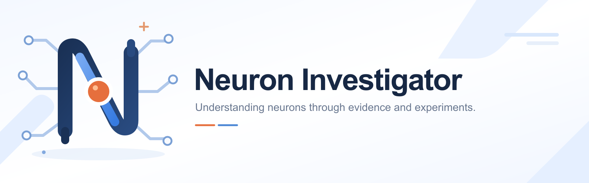
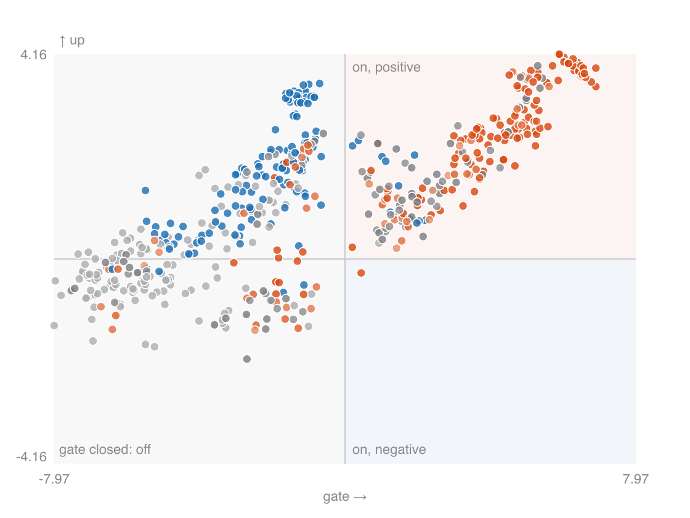

<p align="center">
  
</p>

<h1 align="center">
  Neuron Investigator<br>
  <sub>🔬 Investigating neurons with agents and experiments</sub>
</h1>

<p align="center">
  <a href="docs/method.md"></a>
  <a href="skills/README.md"></a>
  <a href="#reports"></a>
  <a href="#quick-start"></a>
</p>

<p align="center"><b>English</b> · <a href="README_zh.md">简体中文</a></p>

<p align="center">
  <a href="#overview">📖 Overview</a> ·
  <a href="#workflow">⚗️ Workflow</a> ·
  <a href="#reports">🖼️ Reports</a> ·
  <a href="#quick-start">🚀 Quick start</a> ·
  <a href="#documentation">📚 Documentation</a>
</p>

## 📖 Overview <a id="overview"></a>

A three-stage agent pipeline for investigating native MLP neurons in dense Qwen3 models. It starts with saved activation evidence, runs controlled measurements, and produces an interactive HTML report.

## ⚗️ How It Works <a id="workflow"></a>


1. **Prepare evidence.** Read the existing activation archive, draw up to 40 candidates per amplitude interval, retain up to 256 scan points in proportion to the candidate counts, and use DeepSeek to label their observed contexts. This happens before the initial explanation.
2. **Interpret.** A fresh agent container loads `skills/interpret/` and reads only the target neuron's initial HTML and structured evidence.
3. **Experiment.** A fresh container loads `skills/experiment/`. Its tools run replacement sweeps, searches, native interventions, RelP attribution, family measurements, and blind maximum/minimum tests on the host. Saved input prefixes and scoring positions are retained.
4. **Revise.** A fresh container loads `skills/revise/`, reviews the measurements, and revises the explanation, Criticism, and captions. Fixed code assembles the report and cost records.
5. **Publish.** Export the generated report. If a local reference snapshot is available, publication adds a collapsible side-by-side comparison with aligned sections and linked scrolling. Reference content is added only at publication; it is not given to the research agents.

Each agent runs in a separate container with one skill. Host tools handle paths, GPU allocation, accounting, and HTML generation. The default investigator is `deepseek-flash` with `reasoning_effort: high`.

**Semantic Clusters** group measured examples by meaning. Raw NMF routes describe attribution patterns, and a semantic cluster may span several routes. Counts, attribution-mass shares and upstream summaries are computed from the measured members.

## 🖼️ Report Excerpt <a id="reports"></a>

<p align="center">
  
</p>

*Inside the neuron, Qwen3-32B L1/N20535.* Selected corpus and experimental token positions, plotted by raw gate and up. Orange, blue and grey denote positive, negative and mixed or unresolved semantic groups; they do not set an individual point's activation sign. The shaded “closed” half can still have nonzero `SiLU(gate) × up`. These selected samples do not estimate corpus density.

A full report also includes activation examples, token statistics, replacement experiments, attribution graphs, interventions, Criticism and an independent review. Fixed code plots the measurements; agents write the explanations and captions. The [report guide](docs/reports.md) explains how to read these sections and where their data comes from.

## 🚀 Quick Start <a id="quick-start"></a>

### 1. Try the report renderer locally

The demo generates a small synthetic fixture; it is not an experimental result. It needs no API key, Docker, GPU, or downloaded model and also works on macOS.

```bash
git clone https://github.com/RUC-TrustworthyAI/Neuron-Investigator.git
cd Neuron-Investigator
python3 -m venv .venv
source .venv/bin/activate
python -m pip install -r requirements/cpu.txt
python examples/demo.py --output runs/demo
python -m http.server 8000 --directory runs/demo
```

Open **http://localhost:8000/** to view the demo.

For CPU development checks, see [docs/development.md](docs/development.md).

### 2. Configure a real investigation

- Linux, Bash 4+, Docker, and Python 3.10+ for the full pipeline.
- A CUDA-capable host with local dense-Qwen3 model weights. The default GPU group is `[0,1,2,3]`; a group holds one model sharded across its GPUs. The research setup used four A100 40 GB GPUs, but memory use depends on model and prefix length.
- An existing activation archive and per-neuron initial report packages; see [the input contract](docs/data.md).
- A DeepSeek API credential on the host for agents and auxiliary labeling/writing calls.

The agent container does not need CUDA. Model computation runs through host tools, while container inputs are mounted read-only.

```bash
python -m pip install -r requirements/gpu.txt
# Choose a CUDA wheel compatible with your NVIDIA driver:
python -m pip install torch==2.7.1 --index-url https://download.pytorch.org/whl/cu118
docker build -t neuron-investigator:local .
cp settings.json settings.local.json
```

Edit `settings.local.json` to point to your inputs:

```json
{
  "paths": {
    "reports": "/path/to/initial-reports",
    "activations": "/path/to/activation-archive",
    "model": "/path/to/Qwen3-32B",
    "state": "/tmp/neuron-investigator",
    "references": "/path/to/optional-reference-pages"
  },
  "gpu_groups": [[0, 1, 2, 3]]
}
```

This is an excerpt: keep the other settings in the copied file. Relative paths resolve against that file's directory. The report directory contains `Lx_Ny/` packages; reference snapshots, when used, are named `Lx_Ny.html`.

Supply `DEEPSEEK_API_KEY` through your host environment, or set `NEURON_PAPER_API_KEY_FILE` to a local credential file. Do not put credentials in settings. The agent receives a temporary credential for the host API meter, not the upstream key.

### 3. Run and publish

```bash
NEURON_PAPER_BUDGET_USD=5 ./run.sh prepare \
  --settings settings.local.json --output runs/example --neurons L55_N11703
./run.sh execute --run runs/example
./run.sh publish --run runs/example --neuron L55_N11703 --output results/example
python -m http.server 8000 --directory results/example
```

Open **http://localhost:8000/**. Replace the example neuron with one present in your archive.

`prepare` freezes source and settings without calling an LLM or running the model. `execute` performs evidence preparation and the three stages using that snapshot. `publish` adds presentation controls while keeping the generated scientific content unchanged. Exemplars and cluster examples display up to 128 saved tokens before the first highlighted activation; the full measured prefix remains in the data.

The budget applies to all API calls in that batch and stays in host accounting. The default is USD 2; set `NEURON_PAPER_BUDGET_USD=unlimited` explicitly for no cap. Configure the token prices in settings for your API endpoint. They are not account invoices.

For a batch, list several neurons after `--neurons`. By default, the next neuron starts after the previous experiment stage has completed; revision may overlap the next interpretation. `gpu_groups` can list independent GPU groups. See [continuation, isolated stages, and saved-measurement reuse](docs/running.md#start-continue-and-publish).

### 4. Inspect outputs

```text
runs/example/
  manifest.json                 Frozen settings, inputs and budget
  framework-source/             Source snapshot for this run
  logs/api/                     Complete API requests, responses and usage
  logs/usage.json               Accumulated token-price estimates
  units/Lx_Ny/
    01-interpretation/          Preparation and initial explanation
    02-experiments/             Experiments, traces and measurements
    03-revision/                Revised report and independent reading
    */handoff/                  JSON, HTML and artifacts for the next stage
    PIPELINE_TERMINAL.json      Final state and report location
```

Each run retains its requests, measurements and reports. Fresh interpretations use the target activation evidence without previous explanations or official labels.

## 📚 Documentation <a id="documentation"></a>

| Guide | Start here when you want to… |
|---|---|
| [Running](docs/running.md) | Install dependencies, configure GPUs and credentials, run or continue a batch |
| [Input data](docs/data.md) | Prepare an activation archive and target report package |
| [Method and implementation](docs/method.md) | Trace the workflow to code and understand measurement scope |
| [Report guide](docs/reports.md) | Find the source and generation stage of a particular plot or section |
| [Development](docs/development.md) | Run CPU software checks and the offline demo |

<details>
<summary><strong>Repository layout</strong></summary>

```text
run.sh                  Container orchestration and serial handoffs
settings.json           Scientific settings and configurable host paths
Dockerfile              Agent image with pinned harness, jq and ripgrep
skills/                 interpret, experiment, revise
tools/                  Evidence, GPU measurements, rendering and accounting
analysis/               Initial report builders and data-free HTML/JS templates
assets/                 Project banner, workflow diagram and report excerpt
requirements/           Host and development dependencies
tests/                  Software tests and synthetic fixtures
examples/demo.py        Synthetic offline renderer example
docs/                   Setup, data contracts, methods and report guide
```

</details>

## 🤝 Contributing <a id="contributing"></a>

See [CONTRIBUTING.md](CONTRIBUTING.md) and the [development guide](docs/development.md).

## 🙏 Acknowledgements <a id="acknowledgements"></a>

The report structure follows [Goodfire's neuron reports](https://already-clean.goodfire.com/). RelP adapts [TransluceAI/circuits](https://github.com/TransluceAI/circuits), with the source revision recorded in `tools/relp-source.json`. Agents use the official [DeepSeek Harness SDK](https://github.com/deepseek-ai/deepseek-harness/tree/master/python/sdk).

## 📄 License <a id="license"></a>

Original project code uses the [MIT License](LICENSE).
