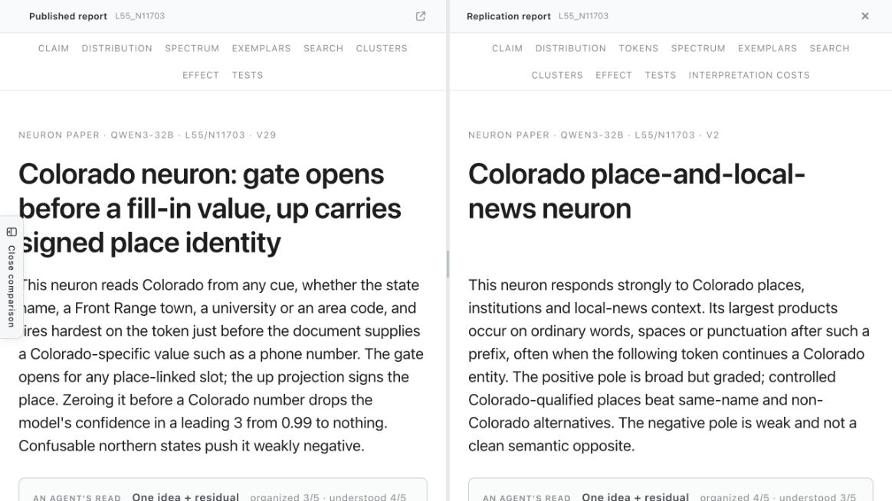
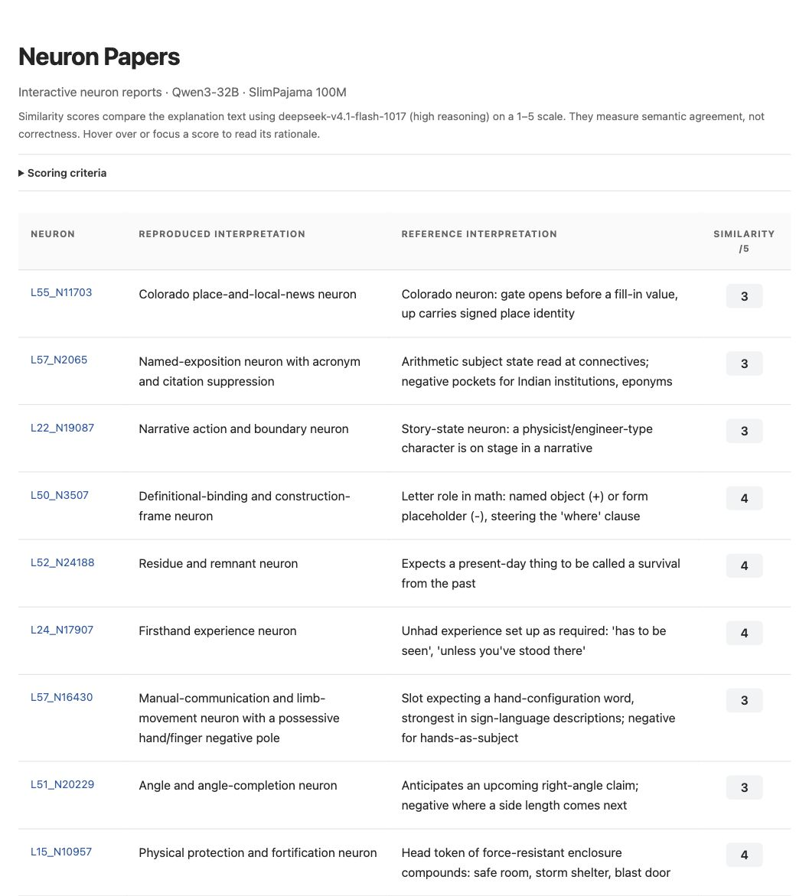
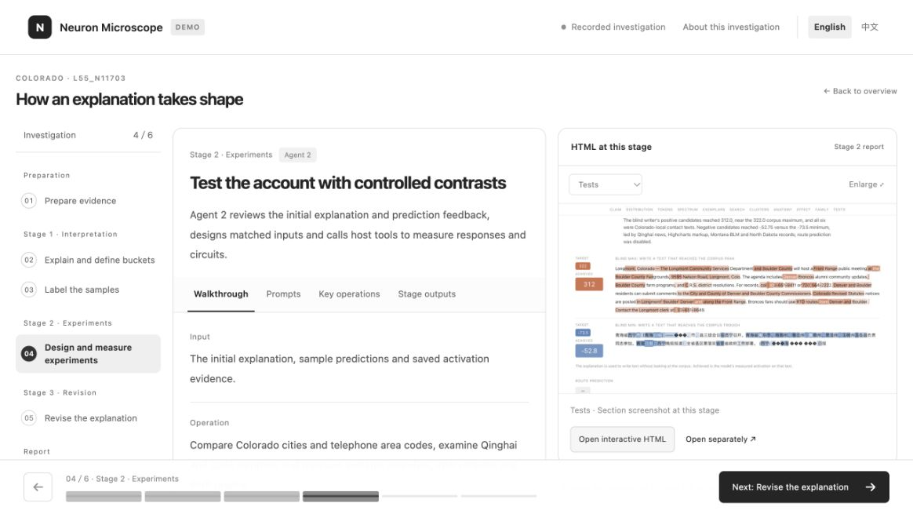
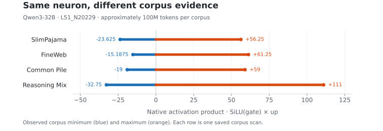

<p align="center">
  
</p>

<h1 align="center">Neuron Microscope</h1>

<p align="center">
  <strong>Can native LLM neurons be explained—and can those explanations survive controlled experiments?</strong>
</p>

<p align="center">
  An open, evidence-first framework for reproducing and stress-testing neuron explanations.
</p>

<p align="center">
  <a href="README_zh.md">中文</a> ·
  <a href="https://ruc-trustworthyai.github.io/Neuron-Microscope-Pages/">Explore neuron reports</a> ·
  <a href="https://ruc-trustworthyai.github.io/Neuron-Microscope-Pages/L55_N11703/">Open the Colorado case</a> ·
  <a href="https://ruc-trustworthyai.github.io/Neuron-Microscope-Pages/walkthrough/?lang=en">Watch the investigation</a> ·
  <a href="#use-neuron-microscope">Run the project</a>
</p>

<p align="center">
  <a href="docs/method.md"></a>
  <a href="docs/workflow.md"></a>
  <a href="docs/reports.md"></a>
  <a href="https://ruc-trustworthyai.github.io/Neuron-Microscope-Pages/walkthrough/?lang=en"></a>
  <a href="#use-neuron-microscope"></a>
</p>

<a id="overview"></a>

Neuron Microscope implements an independent workflow to reproduce and test the neuron analyses behind Nick Cammarata's [*Neural Networks Are Already Clean*](https://already-clean.goodfire.com/). Starting with native MLP neurons in **Qwen3-32B**, our reports expose activation evidence, hypotheses, controlled tests, causal interventions, revisions, and unresolved failures.

**Available now:** [investigation code and prompts](workflow/), [sources, sampling procedures and readers for five corpora](docs/data.md#corpora-used-in-the-comparisons), and [10 interactive neuron comparisons](https://ruc-trustworthyai.github.io/Neuron-Microscope-Pages/). Reports include selected contexts and measurements; full sampled texts and activation archives do not yet have a public download.

> [!IMPORTANT]
> **This is an independent reproduction effort.** The research models do not see AlreadyClean's explanations while conducting an investigation. The reference report is added only when the final report is published for comparison.

## Contents

- [Side-by-side interactive comparisons](#side-by-side-interactive-comparisons)
- [Which AlreadyClean claims have we tested?](#which-alreadyclean-claims-have-we-tested)
- [The investigation pipeline](#the-investigation-pipeline)
- [Evaluating the report evidence](#evaluating-the-report-evidence)
- [Observations from the current comparisons](#observations-from-the-current-comparisons)
- [Installation and usage](#installation-and-usage)
- [Recorded runtime and cost](#recorded-runtime-and-cost)
- [Limitations and future work](#limitations-and-future-work)
- [How to contribute](#how-to-contribute)
- [Related research from our group](#related-research-from-our-group)
- [Setup, data and report guides](#setup-data-and-report-guides)

## Side-by-side interactive comparisons <a id="explore-the-evidence"></a> <a id="reports-and-walkthrough"></a><a id="live-demo"></a><a id="reproduction-results"></a>

### A side-by-side case: the Colorado neuron

Each neuron link opens the original report on the left and our reproduction on the right. Scroll either pane to move both; close the comparison to read the reproduction alone.

[Open the interactive comparison →](https://ruc-trustworthyai.github.io/Neuron-Microscope-Pages/L55_N11703/)

<p align="center">
  <a href="https://ruc-trustworthyai.github.io/Neuron-Microscope-Pages/L55_N11703/">
    
  </a>
</p>

Both reports identify a strong Colorado-related positive response, but they make different claims about what the neuron computes:

- **Published report:** the gate opens before a place-specific fill-in value, while the up projection carries signed place identity.
- **Our reproduction:** the neuron responds broadly to Colorado places, institutions, and local-news contexts.

In our SlimPajama 100M run, the template `Officials in {city} approved the annual budget this week.` produces **+22.0 to +43.3** on the token ` approved` for four Colorado cities, while six other cities remain at **+4.75 or below**. The comparison page exposes the contexts, controlled replacements, attribution results, interventions, and unresolved negative pole.

### Browse all current reports

[Open the report directory →](https://ruc-trustworthyai.github.io/Neuron-Microscope-Pages/)

<p align="center">
  <a href="https://ruc-trustworthyai.github.io/Neuron-Microscope-Pages/">
    
  </a>
</p>

Each row links to a full interactive report with activation evidence, exemplars, searches, clusters, effects, tests, criticism, revised conclusions, and cost records.

## Which AlreadyClean claims have we tested?

The original essay contains claims at several levels. We separate what this repository has directly examined from what remains open.

| Claim or question | Operational evidence needed | Current status |
| --- | --- | --- |
| Can native Qwen3 neurons receive coherent explanations? | Activation coverage, held-out examples, controlled tests, and interventions. | **Preliminary evidence:** several clear cases, several partial or divergent cases. |
| Do the original neuron interpretations reproduce independently? | Blind reproduction followed by side-by-side comparison. | **Mixed and case-dependent** in the first 10 studies. |
| Does corpus choice change the visible behavior? | Matched sampling across corpora. | **Different observed ranges** for L51_N20229; isolating the corpus effect requires matched sampling and context handling. |
| Are weak activations globally unimportant? | Thresholded, whole-network ablations across tasks and layers. | **Not yet tested by this repository.** |
| Does recursive generalization explain apparently mixed behavior? | Evidence that branches share a developmental or causal mechanism. | **Open.** Current reports can generate candidate cases but do not establish the general claim. |
| Are native neurons more useful than SAE features? | Matched neurons/features, data, tests, intervention budgets, and evaluation criteria. | **Planned.** No general comparison is claimed. |

We intend this table to become a living claims tracker. New evidence should link to a concrete report, model, corpus, intervention, or counterexample.

## The investigation pipeline <a id="the-three-stage-investigation-pipeline"></a> <a id="how-an-investigation-works"></a> <a id="workflow"></a>

### Follow a recorded investigation

[Open the recorded walkthrough →](https://ruc-trustworthyai.github.io/Neuron-Microscope-Pages/walkthrough/?lang=en)

<p align="center">
  <a href="https://ruc-trustworthyai.github.io/Neuron-Microscope-Pages/walkthrough/?lang=en">
    
  </a>
</p>

The walkthrough follows the Colorado investigation from saved activation evidence through interpretation, controlled experiments, revision, and publication. It shows the prompts, tool calls, measurements, intermediate reports, and final criticism. This recording uses Diverse 100M; the comparison above uses SlimPajama 100M.

### From evidence to a report

Python orchestrates the investigation through structured LLM requests and model measurements. The LLM proposes explanations, predictions and experimental inputs in defined JSON formats; code selects the evidence, executes the measurements and assembles the report.

1. **Sample evidence.** Draw 500 saved positions across activation bins, allocating samples in proportion to the bins’ log-count heights. Retain their contexts and measured gate, up and product values.
2. **Explain, check and freeze.** Give the explanation model all sampled contexts and measurements. It proposes an explanation with at most three positive and three negative response rules. An independent labeler predicts each sampled response with its activation hidden. The explanation model uses this feedback to refine the explanation and rules once. A second blind labeling pass supplies the predictions used in both plots; the explanation and rules are then frozen before experiments.
3. **Measure.** Search for strong responses with measured feedback, construct controlled tests, and run independent explanation-only maximum/minimum probes. The target model stays loaded while code batches forward measurements and computes attribution, family responses and native interventions. A shared lock serializes measurement stages on each GPU group; explanation and report-analysis requests for different neurons can overlap.
4. **Analyze and publish.** The LLM analyzes support, counterexamples and unresolved patterns while preserving the frozen explanation and rules. An independent reader assesses the account. Fixed code renders the interactive report and, when a reference snapshot is supplied, adds the side-by-side comparison after research is complete.

**Activation spectrum and Inside the neuron share one sample pool and the predictions from the refined, frozen explanation.** The labeler reads the full observed prefix and nearby continuation as linguistic context. It assigns No visible cue when the explanation does not clearly predict either direction. Because these samples inform refinement, their agreement scores provide development feedback. Independent written probes and controlled experiments supply further tests.

See [the workflow](docs/workflow.md), [measurement details](docs/method.md), and [run configuration](docs/running.md).

## Evaluating the report evidence <a id="how-we-evaluate-an-explanation"></a>

The reports provide several ways to examine an explanation. The directory’s 1–5 score measures LLM-assessed semantic agreement with the reference explanation. Correctness and causal claims require the experiments below; similar wording alone does not establish them.

| Dimension | Question | Evidence in the reports |
| --- | --- | --- |
| Coverage | Does the explanation account for both poles and the important residual cases? | Activation spectrum, exemplars, semantic clusters, prediction errors, and “No visible cue” cases. |
| Specificity | Does it identify the trigger rather than merely the surrounding topic? | Controlled replacements, counterexamples, searches, and blind tests. |
| Predictive value | Can the explanation anticipate responses on inputs not used to formulate it? | Independent explanation-only maximum/minimum tests, supported by controlled templates and family measurements. |
| Causal relevance | Does changing the neuron or its inputs have the predicted effect? | Native interventions, ablations, controlled input changes, and output measurements. |
| Stability | Does the interpretation persist across corpora, samples, and agent runs? | Cross-corpus comparisons and planned repeated-run studies. |
| Uncertainty | What remains unexplained or underdetermined? | Explicit criticism, alternative accounts, weak poles, and failed tests. |

RelP provides supporting attribution evidence using modified derivatives; its graphs alone do not establish a native causal effect. See [the measurement scope](docs/method.md#relp-and-intervention-scope).

## Observations from the current comparisons <a id="what-we-have-found-so-far"></a> <a id="key-findings"></a>

### Shared concepts can conceal different response conditions

The following four examples from the SlimPajama 100M comparison set share recognizable concepts with the reference reports. These are qualitative readings of individual cases; the remaining differences still need experimental tests.

| Neuron | Shared interpretation | What still differs |
| --- | --- | --- |
| [L50_N3507](https://ruc-trustworthyai.github.io/Neuron-Microscope-Pages/L50_N3507/) | A mathematical symbol's role separates the two poles: naming an object versus occupying an expression form. | Exact letter, construction, and steering conditions. |
| [L52_N24188](https://ruc-trustworthyai.github.io/Neuron-Microscope-Pages/L52_N24188/) | Remnants and things surviving from the past. | Anticipating a remnant word versus responding to the word itself; the weak negative pole. |
| [L24_N17907](https://ruc-trustworthyai.github.io/Neuron-Microscope-Pages/L24_N17907/) | Firsthand experience presented as necessary, such as “has to be seen.” | How broadly recommendations and unforgettable-experience phrases belong to the concept. |
| [L15_N10957](https://ruc-trustworthyai.github.io/Neuron-Microscope-Pages/L15_N10957/) | Physical protection and fortification, including safe rooms and storm shelters. | Compound-head specificity and generalization to barriers or armor. |

Other cases expose larger gaps. For example, [L31_N23558](https://ruc-trustworthyai.github.io/Neuron-Microscope-Pages/L31_N23558/) receives a broad relational-boundary explanation in our run, whereas the original report distinguishes two mathematical frames. These disagreements are useful: they identify where broader corpora, sharper contrasts, and stronger causal tests are needed.

### Observed activation ranges differ across corpora

At approximately the same 100M-token scale, different corpora expose different activation ranges. For L51_N20229, the observed native product spans **−19 to +59** in Common Pile, **−35 to +98** in Diverse, and **−32.75 to +111** in Reasoning Mix. These are observed extrema, not bounds on the neuron's behavior. The corpora also differ in sampling and context handling; their sources and procedures are documented in the [data guide](docs/data.md#corpora-used-in-the-comparisons).

Equal token budgets can still expose different contexts and activation tails. Wider extrema alone do not establish a better explanation; the cases at both poles and the responses to controlled tests need inspection.

<p align="center">
  <a href="assets/corpus-coverage.svg">
    
  </a>
</p>

The current reports leave uncertainty at three points: whether the sampled corpus contains the relevant contexts, whether the agent sees sufficient evidence at the scored position, and whether its explanation predicts further measurements. Repeated runs and matched comparisons are needed to separate these effects.

## Installation and usage <a id="use-neuron-microscope"></a> <a id="quick-start"></a>

There are three current ways to use the project.

| Mode | What you can do | Requirements |
| --- | --- | --- |
| **Explore** | Inspect 10 interactive neuron comparisons and a recorded investigation. | Browser only. |
| **Try the renderer** | Generate and view a small synthetic report fixture. This tests the software and interface, not a scientific result. | Python; no API key, Docker, GPU, or model download. |
| **Run an investigation** | Analyze neurons from an existing activation archive and publish new reports. | Linux, Python 3.10+, CUDA host, model weights, activation data, and an LLM endpoint. |

### 1. Try the offline renderer

```bash
git clone --branch hr-structured-pipeline https://github.com/RUC-TrustworthyAI/Neuron-Microscope.git
cd Neuron-Microscope

python3 -m venv .venv
source .venv/bin/activate
python -m pip install -r requirements/cpu.txt

python examples/demo.py --output runs/demo
python -m http.server 8000 --directory runs/demo
```

Open <http://localhost:8000/>. The generated content is synthetic and should not be treated as experimental evidence.

### 2. Configure a full investigation

The pipeline requires Linux, Python 3.10+, a CUDA host with local dense-Qwen3 weights, compatible saved activations, an activation-only report package, and an LLM endpoint. Install the measurement dependencies:

```bash
# Choose a PyTorch CUDA wheel compatible with your NVIDIA driver.
python -m pip install torch==2.7.1 --index-url https://download.pytorch.org/whl/cu118
python -m pip install -r requirements/gpu.txt
```

Create `workflow.local.json` using the [configuration example](docs/workflow.md#run). Set the neuron, model, activation and report paths, GPU indices, and shared GPU lock. Configure `llm.model`, reasoning effort and endpoint URLs; the recorded model is `deepseek-v4.1-flash-1017` with `high` reasoning. Supply `DEEPSEEK_API_KEY` in the environment, or point `NEURON_PAPER_API_KEY_FILE` to a local credential file.

```bash
python -m workflow.run --config workflow.local.json --output runs/example
python -m http.server 8000 --directory runs/example/report
```

Append `--stop-after interpretation` to inspect the refined explanation and both labeled plots using saved activations before loading the target model. Repeating the command with the same configuration reuses completed API responses and saved sampling and measurement records. Use a new output directory when changing scientific inputs.

The [run guide](docs/running.md) covers concurrency, continuation, comparison export and execution records.

## Recorded runtime and cost <a id="reproducibility-and-cost"></a>

Each run retains its configuration, API requests and responses, token-price estimates, sampled evidence, explanation and prediction versions, measurements, and final report. Fresh interpretations use the target activation evidence without previous explanations or official labels.

For the recorded Colorado / Diverse 100M investigation on **29 October 2026**:

| Item | Recorded value |
| --- | --- |
| Target model | Qwen3-32B |
| Saved evidence | Diverse 100M; 500 sampled positions; 495 labeled positions plotted |
| Research and auxiliary calls | `deepseek-v4.1-flash-1017`, high reasoning effort |
| GPU group | 4 × NVIDIA A100 40 GB |
| Measured stage execution time | 38 min 00 s |
| GPU experiment time | 10 min 48 s, expressed as four-GPU equivalent time |
| API streaming time | 17 min 22 s |
| Estimated API cost | $0.4871 |
| Start-to-finish elapsed time | 1 h 59 min 25 s, including 1 h 21 min 25 s of gaps between recorded stages |

GPU time includes model loading. GPU and API work can overlap, so their durations do not sum to stage execution time.

This is one measured case, not a per-neuron average. Costs exclude the earlier activation collection and depend on the configured model endpoint and token prices. The underlying breakdown is available in the [published report](https://ruc-trustworthyai.github.io/Neuron-Microscope-Pages/walkthrough/reports/04-published.html#interpretation-costs).

## Limitations and future work

### Current limitations

- The first comparison set contains only 10 neurons and is not a random audit of Qwen3-32B.
- Full activation archives do not yet have a public download; external users currently need to supply compatible input data.
- The offline demo is synthetic and does not reproduce a published scientific result.
- Corpus coverage, prompt choice, evidence presentation, and agent stochasticity can change an interpretation.
- The 1–5 directory score measures semantic agreement, not mechanistic correctness.
- Negative poles and weak activations are often less clearly explained than strong positive responses.
- We have not completed matched native-neuron versus SAE comparisons.

### Future work <a id="future-work"></a>

- [ ] Publish a compact, real-neuron evidence pack that can regenerate one scientific report without the full model or activation archive.
- [ ] Expand from selected examples to a larger, randomized neuron sample.
- [ ] Measure explanation stability across agent runs, prompts, samples, and corpora.
- [ ] Add matched native-neuron and SAE-feature comparisons under the same evaluation protocol.
- [ ] Test major AlreadyClean claims at the claim level, including weak-activation ablation and recursive generalization.
- [ ] Support additional models, layers, languages, and genres.

## How to contribute <a id="contribute"></a>

We welcome evidence that strengthens, narrows, or contradicts an explanation.

Useful contributions include:

- **A new neuron case:** model, layer/neuron ID, corpus, sampling procedure, and a complete report.
- **A counterexample:** the tested context, scoring position, measured response, and the explanation it challenges.
- **A controlled experiment:** matched inputs that distinguish two plausible accounts.
- **A new model or corpus:** compatible activation data with provenance and redistribution terms.
- **An evaluation improvement:** a more reliable test of coverage, prediction, causal relevance, stability, or uncertainty.
- **A pipeline improvement:** clearer evidence presentation, more robust tools, lower compute requirements, or better reproducibility.

Please open a [GitHub Issue](https://github.com/RUC-TrustworthyAI/Neuron-Microscope/issues) with a concrete neuron ID, context, experiment, result, or proposal. Reproducible examples are especially valuable, including failures and disagreements.

## Related research from our group <a id="related-work"></a>

Our group's related work spans feature learning, concept-based analysis, explanation evaluation, and LLM safety. Publication details are also listed on [Xiting Wang's faculty page](https://ai.ruc.edu.cn/szdw/zrjs/wxt/index.htm).

| Work | Connection | Links |
| --- | --- | --- |
| **C²R: Cross-sample Consistency Regularization Mitigates Feature Splitting and Absorption in Sparse Autoencoders** — Haoran Jin et al., ICML 2026 | Encourages consistent latent assignments across samples to reduce feature splitting and absorption in SAEs. | [Paper](https://arxiv.org/abs/2606.30609) · [Code](https://github.com/hr-jin/Cross-sample-Consistency-Regularization) |
| **Uncovering Safety Risks of Large Language Models through Concept Activation Vector** — Zhihao Xu et al., NeurIPS 2024 | Uses safety concept activation vectors to investigate model safety mechanisms and vulnerabilities. | [Paper](https://arxiv.org/abs/2404.12038) · [Code](https://github.com/SproutNan/AI-Safety_SCAV) |
| **Evaluating Readability and Faithfulness of Concept-based Explanations** — Meng Li et al., EMNLP 2024 | Formalizes concept-based explanations and develops measures of readability and faithfulness. | [Paper](https://aclanthology.org/2024.emnlp-main.36/) · [Code](https://github.com/hr-jin/Concept-Explanation-Evaluation) |
| **Do LLMs Know Their Vulnerable Scenarios?** — Ziheng Peng et al., arXiv 2026 | Uses SAE concepts and causal attribution to identify scenarios that suppress refusal. | [Paper](https://arxiv.org/abs/2607.23496) |

## Setup, data and report guides <a id="documentation"></a>

| Guide | Start here when you want to… |
| --- | --- |
| [Running](docs/running.md) | Install dependencies, configure GPUs and credentials, and run or continue a batch. |
| [Input data](docs/data.md) | Prepare an activation archive and target report package. |
| [Method and implementation](docs/method.md) | Trace the workflow to code and understand the measurement scope. |
| [Report guide](docs/reports.md) | Find the source and generation stage of a particular plot or section. |
| [Development](docs/development.md) | Run CPU software checks and the offline demo. |
| [Prompts and output contracts](workflow/) | Inspect the explanation, labeling, experimental-design and report-analysis requests. |

## Citation

If you use Neuron Microscope in academic work, please cite the repository and the specific release or report used:

```bibtex
@software{ruc_trustworthyai_neuron_microscope_2026,
  author = {{RUC-TrustworthyAI}},
  title = {Neuron Microscope: Reproducing and Stress-Testing Native Neuron Explanations},
  year = {2026},
  url = {https://github.com/RUC-TrustworthyAI/Neuron-Microscope}
}
```

## Acknowledgements

The report structure follows [Goodfire's neuron reports](https://already-clean.goodfire.com/). RelP adapts [`TransluceAI/circuits`](https://github.com/TransluceAI/circuits), with the source revision recorded in `tools/relp-source.json`. The bundled skill tools use the official [DeepSeek Harness SDK](https://github.com/deepseek-ai/deepseek-harness/tree/master/python/sdk).

## License

Code in this repository is released under the [MIT License](LICENSE). Third-party components retain their original licenses.
