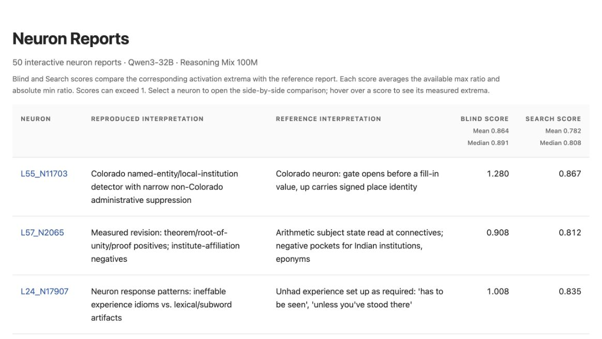
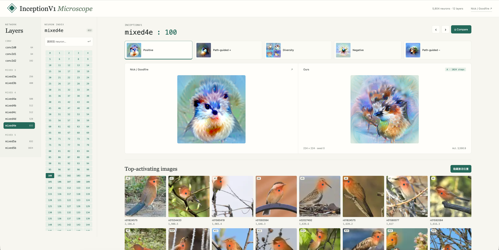
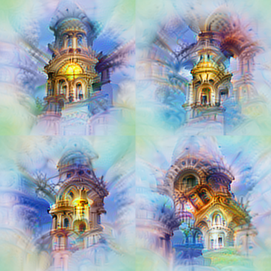
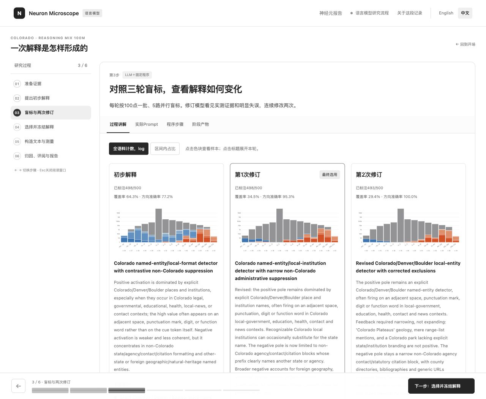

<p align="center">
  
</p>

<h1 align="center">Neuron Microscope</h1>

<p align="center">
  <strong>研究语言模型与视觉模型中的原生神经元。</strong>
</p>

<p align="center">
  <a href="README.md">English</a> ·
  <a href="https://ruc-trustworthyai.github.io/Neuron-Microscope-Pages/reasoning-mix-100m-50/">语言模型报告</a> ·
  <a href="vision/README_zh.md">视觉模型可视化</a> ·
  <a href="https://ruc-trustworthyai.github.io/Neuron-Microscope-Pages/reasoning-mix-100m-50/L55_N11703/?compare=1">查看 Colorado 案例</a> ·
  <a href="https://ruc-trustworthyai.github.io/Neuron-Microscope-Pages/walkthrough/language/?lang=zh">语言模型研究流程</a> ·
  <a href="#use-neuron-microscope">运行项目</a>
</p>

<p align="center">
  <a href="https://ruc-trustworthyai.github.io/Neuron-Microscope-Pages/reasoning-mix-100m-50/"></a>
  <a href="vision/README_zh.md"></a>
  <a href="https://ruc-trustworthyai.github.io/Neuron-Microscope-Pages/walkthrough/language/?lang=zh"></a>
  <a href="#use-neuron-microscope"></a>
</p>

<a id="overview"></a>

Neuron Microscope 独立复现并研究 Nick Cammarata 的 [*Neural Networks Are Already Clean*](https://already-clean.goodfire.com/) 中的神经元分析。项目包含 **Qwen3-32B 语言模型研究**与 **InceptionV1 特征可视化**。

| 模型 | 可以查看的内容 | 入口 |
| --- | --- | --- |
| **Qwen3-32B** | 激活证据、解释、受控测试、干预和尚未解决的案例。 | [交互式神经元报告](https://ruc-trustworthyai.github.io/Neuron-Microscope-Pages/reasoning-mix-100m-50/) · [研究代码](language/) |
| **InceptionV1／Lucent Inception5h** | 五种可视化目标、自然图像样例、热图和参考对比。 | [视觉模块指南与样例](vision/README_zh.md) · [优化代码](vision/vision-repro/) |

**数据：** 当前 50 份报告均使用 **Reasoning Mix 100M**。[数据指南](language/docs/data.md)介绍了语料来源、激活格式和读取工具。报告包含选定的上下文和测量结果；完整采样文本与激活归档尚无公开下载入口。

> **[发现总结](#key-findings)：** 在我们观察的 50 个 Qwen3-32B 神经元中，绝大多数的强激活文本都呈现出清楚的语义、语法或词形规律。但这些规律仍难解释弱激活，也难以准确预测一句话中强激活会落在哪个 token 上。

## 📑 目录 <a id="contents"></a> <a id="目录"></a>

- [💬 语言模型神经元报告](#language-model-neuron-reports)
- [🖼️ 视觉模型神经元可视化](#vision-model-neuron-visualizations)
- [💡 主要发现](#key-findings)
- [🧪 LLM 神经元研究流程](#the-investigation-pipeline)
- [🔬 视觉神经元研究流程](#the-vision-investigation-pipeline)
- [⚖️ 如何评估报告中的证据](#evaluating-the-report-evidence)
- [📦 安装与使用](#installation-and-usage)
- [⏱️ 实测耗时与开销](#recorded-runtime-and-cost)
- [🚧 当前局限](#limitations-and-future-work)
- [🚀 未来工作](#future-work)
- [🤝 如何参与项目](#how-to-contribute)
- [📖 环境、数据与报告指南](#setup-data-and-report-guides)
- [📚 团队相关研究](#related-research-from-our-group)

## 💬 语言模型神经元报告 <a id="language-model-neuron-reports"></a> <a id="side-by-side-interactive-comparisons"></a> <a id="explore-the-evidence"></a><a id="reports-and-walkthrough"></a><a id="live-demo"></a><a id="reproduction-results"></a> <a id="语言模型神经元报告"></a>

### 双栏案例：Colorado 神经元

打开神经元链接后，左侧显示原报告，右侧显示我们的复现。滚动任意一侧会同步移动两份报告；关闭双栏后可以单独阅读复现报告。

[打开交互式对比 →](https://ruc-trustworthyai.github.io/Neuron-Microscope-Pages/reasoning-mix-100m-50/L55_N11703/?compare=1)

<p align="center">
  <a href="https://ruc-trustworthyai.github.io/Neuron-Microscope-Pages/reasoning-mix-100m-50/L55_N11703/?compare=1">
    
  </a>
</p>

两份报告都发现了较强的 Colorado 正向响应，但对神经元具体计算什么提出了不同解释：

- **原报告：** gate 会在即将填入地区相关信息的位置打开，up 投影承载带符号的地区身份。
- **我们的复现：** 正极响应与 Colorado 地名、机构名有关，出现在地方政府、教育、医疗、联系信息和新闻上下文中。负极解释限于部分非 Colorado 机构的行政联系信息与引文格式。

在 Reasoning Mix 100M 研究中，`Contact block: {slot} End of contact.` 中的六组 Colorado 机构联系信息达到 **+188 至 +352**。每组取替换片段内绝对值最大的有符号响应，这六组的峰值都落在空格上。三组外州机构的响应为 **-26.5 至 +42.75**，使用 Colorado `720` 区号的通用诊所仍达到 **+165**。这些结果支持 Colorado 相关响应，但机构名、区号和格式各自的作用仍需分开检验。报告保留了完整文本、归因结果、干预和反例。

### 浏览当前全部报告

查看 **Reasoning Mix 100M 上的 50 个 Qwen3-32B 神经元报告**，导航页同时列出各报告的 Blind 和 Search 分数。

[打开报告目录 →](https://ruc-trustworthyai.github.io/Neuron-Microscope-Pages/reasoning-mix-100m-50/)

<p align="center">
  <a href="https://ruc-trustworthyai.github.io/Neuron-Microscope-Pages/reasoning-mix-100m-50/">
    
  </a>
</p>

每一行都可进入完整交互式报告，查看激活证据、样例、搜索、聚类、效应、测试、批评、独立评阅和开销记录。两列各有 49 个有效分数：**Blind 均值为 0.864，中位数为 0.891；Search 均值为 0.782，中位数为 0.808**。导航页也在列标题中展示这些统计值。

## 🖼️ 视觉模型神经元可视化 <a id="vision-model-neuron-visualizations"></a> <a id="vision-neuron-visualizations"></a> <a id="视觉模型神经元可视化"></a>

[Vision 模块](vision/README_zh.md)已发布 InceptionV1 全部 **12 层、5,804 个 neuron** 的五类可视化：Positive、Path-guided +、Diversity、Negative 和 Path-guided −，共 **29,020 组结果、46,432 张优化图**。每个 neuron 还提供从 50,000 张 ImageNet 训练图片中检索的 Top 16、Additional Examples 和负向样例，支持感受野裁剪与激活热图。

[打开交互网页 →](https://vision-neuron-microscope.tart-olm-9383.chatgpt.site/?layer=mixed4c&neuron=477&compare=1)

<p align="center">
  
</p>

[五类结果对比 →](vision/README_zh.md#reproduction-results)

<table align="center">
  <thead>
    <tr><th scope="col">来源</th><th scope="col">Positive</th><th scope="col">Path-guided +</th><th scope="col">Diversity</th><th scope="col">Negative</th><th scope="col">Path-guided −</th></tr>
  </thead>
  <tbody>
    <tr>
      <th scope="row"><a href="https://already-clean.goodfire.com/microscope/inceptionv1.html?layer=mixed4c&amp;neuron=477">Nick / Goodfire</a></th>
      <td><a href="https://already-clean.goodfire.com/microscope/inceptionv1/fv/positive/mixed4c/477.png"></a></td>
      <td><a href="https://already-clean.goodfire.com/microscope/inceptionv1/fv/path_positive/mixed4c/477.png"></a></td>
      <td><a href="https://already-clean.goodfire.com/microscope/inceptionv1/fv/diversity/mixed4c/477.png"></a></td>
      <td><a href="https://already-clean.goodfire.com/microscope/inceptionv1/fv/negative/mixed4c/477.png"></a></td>
      <td><a href="https://already-clean.goodfire.com/microscope/inceptionv1/fv/path_negative/mixed4c/477.png"></a></td>
    </tr>
    <tr>
      <th scope="row">Ours</th>
      <td><a href="vision/docs/assets/mixed4c_477/positive.png"></a></td>
      <td><a href="vision/docs/assets/mixed4c_477/path_positive.png"></a></td>
      <td><a href="vision/docs/assets/mixed4c_477/diversity.png"></a></td>
      <td><a href="vision/docs/assets/mixed4c_477/negative.png"></a></td>
      <td><a href="vision/docs/assets/mixed4c_477/path_negative.png"></a></td>
    </tr>
  </tbody>
</table>

**mixed4c · 477**。我们的结果使用 A 配置、224 × 224 输入和 1,024 步优化。Positive 最大化 post-ReLU 激活；Negative 最小化有符号 pre-ReLU 激活。Diversity 每组包含四张图片。

模型使用固定版本的 **Lucent Inception5h**。[方法说明（英文）](vision/docs/methodology.md)介绍了优化目标、颜色先验与自然样例的采样方式。可按[安装与运行指南](vision/README_zh.md#quick-start)复现这些结果。

## 💡 主要发现 <a id="key-findings"></a> <a id="which-alreadyclean-claims-have-we-tested"></a> <a id="我们检验了哪些-alreadyclean-主张"></a> <a id="observations-from-the-current-comparisons"></a> <a id="what-we-have-found-so-far"></a> <a id="当前案例中的观察"></a>

### 1. 原生神经元的强激活往往呈现清楚的语义

例如 [Colorado 相关上下文](https://ruc-trustworthyai.github.io/Neuron-Microscope-Pages/reasoning-mix-100m-50/L55_N11703/?compare=0#exemplars)、[“has to be seen / experienced”表达的亲身体验](https://ruc-trustworthyai.github.io/Neuron-Microscope-Pages/reasoning-mix-100m-50/L24_N17907/?compare=0#exemplars)，以及[数学字母所扮演的角色](https://ruc-trustworthyai.github.io/Neuron-Microscope-Pages/reasoning-mix-100m-50/L50_N3507/?compare=0#exemplars)。这种可读性很像我们在 SAE latents 中寻找的可解释特性，鼓励我们把更多研究精力投入原生神经元。

### 2. 我们仍难以声称完全理解了神经元

找到神经元的主要语义规律，是理解它的起点。更完整的解释，还应说明它在什么条件下、哪些位置产生强响应，以及为什么其他位置没有同样的响应。

[Colorado 报告](https://ruc-trustworthyai.github.io/Neuron-Microscope-Pages/reasoning-mix-100m-50/L55_N11703/?compare=0#exemplars)提供了一个具体例子。强正激活的上文往往包含 Colorado 相关信息，但高激活只出现在其中一部分位置，响应也没有局限在几个固定 token 上。我们常能预判一句话可能包含强响应，却仍难以准确预测它出现在哪个 token，以及其他位置为什么响应很弱。

[Cammarata](https://already-clean.goodfire.com/#:~:text=On%20Simulation%20Scores)指出，逐 token 模拟还需要理解 attention 如何把信息放到逗号等位置。这些细节未必是描述神经元主要语义功能所必需的。[Gao](https://www.lesswrong.com/posts/Dkh7pXKjoNWkkxQDz/neural-networks-are-not-already-clean)则建议，根据模拟误差对模型输出分布的影响来评价解释。这样可以容许不影响行为的位置差异，同时要求解释那些确实影响行为的差异。

为了量化这一差距，我们冻结了 50 个 Qwen3-32B 神经元的解释及正负桶规则，在 1,000 段未向解释、修订模型展示的文本上进行测试。LLM 能看到完整前文、最多 128 个带编号的 token，以及紧邻其后的 10 个 token。它需要判断片段是否包含强响应，并为每个方向选出三个候选位置。随后，我们用保存的实测激活核对预测，全程不提供测量反馈。

| 指标 | 结果 |
|---|---:|
| 强激活片段识别（平衡准确率） | **79.2%** |
| 3 个候选位置的平均命中数 | **0.52 / 3 positions** |
| 平均命中数（允许 ±2 token 偏差） | **1.10 / 3 positions** |

结果表明，通过语义解释可以大致判断神经元会在什么样的上下文中激活，但仍难准确预测它具体在哪个 token 上激活。

### 3. Superposition 可能仍然存在

**原生表示中可能仍然存在 [superposition](https://transformer-circuits.pub/2022/toy_model/index.html)**。原博客的 V-shaped feature 案例用共同形状解释了不同图像；在我们检查的许多神经元中，强弱响应之间的共同语义模式仍不清楚。

一个具体例子是 [L55_N14892 的 Exemplars](https://ruc-trustworthyai.github.io/Neuron-Microscope-Pages/reasoning-mix-100m-50/L55_N14892/?compare=0#exemplars)：Ada 属性说明达到 **+57**，OpenSSH 文档达到 **-72.5**，强响应的程序语境较清楚。但在同一报告的 [Activation spectrum](https://ruc-trustworthyai.github.io/Neuron-Microscope-Pages/reasoning-mix-100m-50/L55_N14892/?compare=0#spectrum) 中，磷酸酶释义在空格处达到 **+11.5625**，正态分布解题在 `1` 处达到 **+11**。这两例约为正极语料最高值的五分之一，它们与当前以 Ada／SQL 为中心的正极解释有何联系，仍不清楚。在 Spectrum 中选择 **No visible cue** 与 **8…16** 激活区间，即可查看这两个样例。

[Leo Gao 的回应](https://www.lesswrong.com/posts/Dkh7pXKjoNWkkxQDz/neural-networks-are-not-already-clean)也指出，激活幅度可能承载重要信息，并认为消融较小的神经元激活可能明显损害模型表现。因此，弱响应也值得与强响应一起研究。检验这一解释还需要特征分解与受控干预。

### 4. 神经元解释受数据集影响

[L49_N11562](https://ruc-trustworthyai.github.io/Neuron-Microscope-Pages/reasoning-mix-100m-50/L49_N11562/?compare=0#exemplars)提供了一个直接的对照。在 Reasoning Mix 100M 中，书目条目在标题后的换行处反复出现强负响应，两篇样例分别达到 **-37 和 -36**；原报告的语料最低值为 **-11.8125**，其中最强负例主要呈现配置块和代码声明上下文。我们观察到的更强负极，让书目标题边界在解释中更加突出。

相反的情况也会出现。[L26_N8504](https://ruc-trustworthyai.github.io/Neuron-Microscope-Pages/reasoning-mix-100m-50/L26_N8504/?compare=0#distribution) 在我们的语料中范围为 **-4.15625 至 +11.8125**，原报告为 **-7.5 至 +21.25**，两端绝对值都只达到原报告的约 55%。我们的解释仍较零散，包括字母片段和空白；原报告则聚焦于具体的空白对齐模式。语料中的强响应样例不足，可能是这种差异的原因之一。

对 **L51_N20229** 分别进行约 100M token 的扫描，也会观察到不同的激活范围：

<p align="center">
  <a href="assets/corpus-coverage.svg">
    
  </a>
</p>

这 50 个神经元来自已有公开报告，尚不足以估计整个模型的可解释比例。

## 🧪 LLM 神经元研究流程 <a id="the-investigation-pipeline"></a> <a id="the-three-stage-investigation-pipeline"></a> <a id="how-an-investigation-works"></a><a id="workflow"></a> <a id="llm-神经元研究流程"></a>

### 跟随一份完整研究记录

[打开语言模型研究过程记录 →](https://ruc-trustworthyai.github.io/Neuron-Microscope-Pages/walkthrough/language/?lang=zh)

<p align="center">
  <a href="https://ruc-trustworthyai.github.io/Neuron-Microscope-Pages/walkthrough/language/?lang=zh#loops">
    
  </a>
</p>

这份记录展示了 **Reasoning Mix 100M 上的 L55_N11703** 从已有证据到最终报告的过程，包括各步提示词、输入节选、结构化输出、三版解释与盲标结果、实测实验和开销。选中的解释在构造文本和 GPU 实验前冻结。

### 当前可运行流程

`language/` 中的代码直接调用 LLM API，并组织目标模型测量。LLM 按约定的 JSON 格式返回解释、预测和实验输入；Python 负责选择证据、执行测量并生成 HTML。提出、修订和评估解释的 LLM 不接收 AlreadyClean 的解释。提供原报告快照时，程序在发布阶段加入对比。配置生成器提供下述设置。

1. **抽取证据。** 将 500 个位置均分到非空激活区间，并在各区间对应的完整语料中取样。只有某区间的全部位置仍不够配额时，才把余量分给其他区间。归档保留 gate、up 和 product 三个通道；解释模型只看 product 值，并结合上下文、极值 token、不同文档的代表样例、分位样本、token 选择性、峰值统计和直接 logit 效应。
2. **解释、检验并冻结。** 正负极各最多提出五条规则，规则说明与正文共同表达同一份解释。盲标模型在隐藏实测值的情况下预测采样位置，每批最多 100 点，五路并行。模型修订两次，每次读取紧前一版解释、500 点实测上下文和重点错误反馈，再完成一轮盲标。三版中，优先从方向准确率 **>90%** 的版本里选择覆盖率最高的；均未达标时，选择准确率最高的。解释及其对应标签一起冻结。某一极证据不足时，可以保留为未解释。
3. **执行测量。** Search 根据实测反馈进行三轮搜索，每轮请求六个区域，每区 16 条文本。模型设计四组受控测试，每组十个条件，测量后改进一次测试设计；头图来自这些受控测试。独立的 Blind 写作模型只看冻结解释与规则，为每个有解释支持的方向构造六条文本。Search 和 Blind 取全文最高或最低激活；受控测试测替换片段、共同后缀或指定 token。GPU 还批量计算归因，测量目标及相关神经元的响应（Family），并执行干预。启用共享 worker 后，同一份常驻模型按队列服务多个运行，期间各运行的 API 请求可以并行。
4. **分析并发布。** LLM 在保留冻结解释与规则的前提下，分析支持证据、反例和尚未解释的现象，再由独立读者评估。固定代码生成交互式报告。

**Activation spectrum 与 Inside the neuron 共用一组样本，以及修订后冻结解释所对应的预测。** 打标模型读取完整上文，并将紧邻后文作为语言背景；解释无法明确预测方向时，归入 No visible cue。由于这些样本参与解释修订，预测一致程度用于提供开发反馈。独立生成的盲测文本与受控实验提供进一步检验。

具体见[流程说明](language/docs/workflow.md)、[测量细节](language/docs/method.md)与[运行配置](language/docs/running.md)。

## 🔬 视觉神经元研究流程 <a id="the-vision-investigation-pipeline"></a> <a id="视觉神经元研究流程"></a>

`vision/` 结合自然图像检索与图像优化，研究固定版本 Lucent Inception5h 中指定层和通道的响应。

1. **选择神经元。** 加载固定检查点，指定要研究的层和通道。
2. **准备自然样例。** 扫描 50,000 张 ImageNet 训练图片，检索较强的正负响应样例，计算激活热图和路径锚点，并按感受野裁剪激活极值附近的展示区域。
3. **优化五种视图。** 在 Fourier 空间中优化图像，结合拟合的颜色基、逐步解锁频段、模糊退火和 Gaussian 加权激活目标。Positive 最大化 post-ReLU 激活；Negative 最小化有符号的 pre-ReLU 激活。Path-guided + 和 Path-guided − 在早期加入自然样例锚点引导。Diversity 为四张正向图像加入多样性目标。
4. **导出并比较。** 生成交互式 HTML，展示优化图像、优化过程中的检查点、自然样例、激活热图和 Nick / Goodfire 的参考结果。

具体见[视觉研究流程](vision/README_zh.md#workflow)、[目标与测量细节](vision/docs/methodology.md)和[运行指南](vision/docs/reproduction.md)。

## ⚖️ 如何评估报告中的证据 <a id="evaluating-the-report-evidence"></a> <a id="how-we-evaluate-an-explanation"></a> <a id="如何评估报告中的证据"></a>

当前目录展示 **Blind score** 和 **Search score**。两者均计算复现最高值／原报告最高值，以及 |复现最低值／原报告最低值|，再对可用比值求平均。分数可以超过 1；汇总均值和中位数时排除缺失值。Blind 使用仅根据冻结解释编写的文本，Search 则使用实测反馈。这些极值用于衡量相对原报告的响应强度；因果判断仍需结合以下实验。

| 维度 | 问题 | 报告中的证据 |
| --- | --- | --- |
| 覆盖度 | 能否解释正负两极和重要的剩余案例？ | 激活谱、样例、语义聚类、预测错误与 No visible cue 案例。 |
| 特异性 | 能否识别具体触发条件，并与周围主题区分？ | 受控替换、反例、搜索和盲测。 |
| 预测能力 | 能否预测形成解释时未使用的输入？ | 独立的最大／最小响应盲测仅根据解释生成候选文本，受控模板与相关神经元的响应测量提供补充证据。 |
| 因果相关性 | 改变神经元或输入，是否产生预期影响？ | 原生干预、消融、受控输入修改和输出测量。 |
| 稳定性 | 换样本、提示词或独立运行，解释是否仍成立？ | 在匹配条件下比较解释与测量结果。 |
| 不确定性 | 哪些现象仍未解释，或证据不足以区分？ | 明确的批评、替代解释、弱响应极和失败测试。 |

RelP 使用修改后的导数提供辅助归因证据，仅凭归因图无法确立原生因果效应。具体见[测量范围](language/docs/method.md#relp-and-intervention-scope)。

## 📦 安装与使用 <a id="use-neuron-microscope"></a><a id="installation-and-usage"></a><a id="quick-start"></a> <a id="安装与使用"></a>

可以根据目标模型与证据选择入口。

| 方式 | 可以做什么 | 需要什么 |
| --- | --- | --- |
| **浏览结果** | 查看 LLM 报告、完整研究记录与视觉对比。 | 浏览器。 |
| **体验渲染器** | 使用合成数据检查报告生成与交互功能。 | Python；无需 API 密钥、Docker、GPU 或模型下载。 |
| **开展 LLM 研究** | 分析已有激活归档中的神经元，发布新报告。 | Linux、Python 3.10+、CUDA 主机、模型权重、激活数据和 LLM 端点。 |
| **可视化视觉神经元** | 优化图像并导出 InceptionV1 网页。 | Python 3.11+、独立环境、模型资产，以及用于优化的 CUDA 主机，见[视觉模块配置](vision/README_zh.md#quick-start)。 |

### 1. 体验离线渲染器

```bash
git clone https://github.com/RUC-TrustworthyAI/Neuron-Microscope.git
cd Neuron-Microscope

python3 -m venv .venv
source .venv/bin/activate
python -m pip install -r language/requirements/cpu.txt

python language/examples/demo.py --output runs/demo
python -m http.server 8000 --directory runs/demo
```

打开 <http://localhost:8000/>。

### 2. 采集激活证据

使用 Linux、Python 3.10+、CUDA 主机和本地 dense-Qwen3 权重。安装采集与测量依赖：

```bash
# 安装与 NVIDIA 驱动匹配的 PyTorch CUDA wheel。
python -m pip install torch==2.7.1 --index-url https://download.pytorch.org/whl/cu118
python -m pip install -r language/requirements/gpu.txt
```

从本地 JSONL 或 Parquet 文件采集 100M tokens。JSONL 每条记录应包含字符串字段 `text`，其他字段名可用 `--text-column` 指定。`--corpus` 可以传入文件、加引号的通配符或目录。

```bash
python -m language.collection \
  --model /path/to/Qwen3-32B \
  --corpus /path/to/reasoning-mix \
  --neurons L55_N11703 L57_N2065 L24_N17907 L50_N3507 \
  --tokens 100000000 --gpus 0 1 2 3 \
  --output data/reasoning-mix-100m
```

命令用种子 42 打乱文档顺序，每篇取开头最多 4,096 个 token，并裁剪最后一篇的前缀以达到预算。程序保存原生 gate、up、product 激活、对应的 token ID、文档位置、直方图和索引，然后在 `data/reasoning-mix-100m/reports/<neuron-id>/` 生成带有 token 统计表和静态 logit 效应的初始报告。100M tokens 的三个 BF16 通道每个神经元约占 600 MB，此外还需保存输入数据和报告。相同命令再次运行时，会复用已完成的输入准备、激活分片和报告。输出目录和批次设置见[数据指南](language/docs/data.md#collect-activations-from-local-text)。

### 3. 配置 LLM 研究

使用生成的归档和目标神经元的初始报告，创建 `workflow.local.json`：

```bash
python language/examples/configure.py \
  --neuron L55_N11703 \
  --model /path/to/Qwen3-32B \
  --report data/reasoning-mix-100m/reports/L55_N11703 \
  --activations data/reasoning-mix-100m \
  --gpus 0 1 2 3 \
  --output workflow.local.json
```

核对生成配置中的 `llm.model`、推理级别、端点地址和 token 单价。随附配置使用 `deepseek-flash` 和 `high` 推理；报告中的模型标识为 `deepseek-v4.1-flash-1017`。在环境中提供 `DEEPSEEK_API_KEY`，或通过 `NEURON_PAPER_API_KEY_FILE` 指向本地凭证文件。

```bash
NEURON_MICROSCOPE_GPU_WORKER=1 python -m language \
  --config workflow.local.json --output runs/example
python -m http.server 8000 --directory runs/example/report
```

添加 `--stop-after interpretation`，即可利用已有激活查看修订后的解释和两张标注图，此时尚未加载目标模型。使用相同配置再次运行时，会复用已完成的 API 响应，以及已保存的采样和测量记录。更改科学输入时，应使用新的输出目录。

并行研究多个神经元时，为每个运行分别准备配置和输出目录；共用 GPU 组的运行应使用相同的 `gpu_lock`。`NEURON_MICROSCOPE_GPU_WORKER=1` 启用共享常驻模型。随附配置的 `llm.max_concurrent_requests: null` 不设置应用层 API 并发上限。继续执行、双栏导出和执行记录见[运行说明](language/docs/running.md)。

## ⏱️ 实测耗时与开销 <a id="recorded-runtime-and-cost"></a> <a id="reproducibility-and-cost"></a> <a id="实测耗时与开销"></a>

统计来自当前发布的 **50 份 Reasoning Mix 100M／Qwen3-32B 报告**中的 Interpretation Costs 记录。表中为每个神经元的算术平均值。

| 项目 | 每个神经元平均值 |
| --- | --- |
| 执行耗时 | 1 小时 13 分 45 秒 |
| GPU 实验时间 | 5 分 9 秒 |
| GPU 使用量 | 0.343 GPU 卡时 |
| API 流式响应时间 | 23 分 52 秒 |
| API 请求数 | 27.46 次 |
| API 费用估算 | $0.7821 |

执行耗时包含 GPU 排队等待，GPU 时间包含模型加载和测量。API 并发响应时，重叠时间只计一次。GPU 与 API 任务可以重叠，激活采集开销另计。各项明细见 [50 份报告](https://ruc-trustworthyai.github.io/Neuron-Microscope-Pages/reasoning-mix-100m-50/)。

## 🚧 当前局限 <a id="limitations-and-future-work"></a> <a id="局限与未来工作"></a> <a id="当前局限"></a>

- 当前集合包含 50 个已有原报告的神经元，结果尚无法推广到 Qwen3-32B 的全部神经元。
- 完整激活归档尚无公开下载入口，外部用户目前需要提供兼容的输入数据。
- 语料覆盖、提示词选择、证据展示与 LLM 随机性都可能改变解释。
- Blind 和 Search 分数比较激活极值，无法证明机制解释正确；对可用方向求平均时，也可能只包含单极。
- 负极和弱激活的解释往往不如强正向响应清楚。
- 我们尚未完成条件匹配的原生神经元与 SAE 比较。

## 🚀 未来工作 <a id="future-work"></a>

1. **构造足够多样的神经元解释数据集。** 扩展语言、领域、文体与表达形式，尽量让每个被测神经元都遇到能在正负两极产生较强响应的输入，同时保留弱响应，支持跨激活范围检验解释。
2. **改进神经元解释流程，提高可靠性。** 改进证据选择、解释修订与反例测试，让流程更可靠地预测激活方向、幅度和具体位置，并衡量独立运行之间的稳定性。
3. **引入更多被测模型，完善评测标准。** 扩展模型家族，从语义覆盖、token 级预测、弱激活、受控干预和下游行为影响等方面，更全面地评估神经元解释。

## 🤝 如何参与项目 <a id="how-to-contribute"></a> <a id="contribute"></a> <a id="如何参与项目"></a>

欢迎提供支持、限定或反驳某项解释的证据。

以下内容都有助于改进项目：

- **新的神经元案例：** 模型、层与神经元 ID、语料、采样过程和完整报告。
- **反例：** 测试上下文、评分位置、实测响应及所挑战的解释。
- **受控实验：** 能够区分两种合理解释的匹配输入。
- **新模型或语料：** 格式兼容的激活数据，以及来源与再分发条件。
- **评估改进：** 更可靠地检验覆盖、预测、因果相关性、稳定性或不确定性。
- **Pipeline 改进：** 更清晰的证据展示、更可靠的工具、更低的计算需求或更容易复现的流程。

可以通过 [GitHub Issue](https://github.com/RUC-TrustworthyAI/Neuron-Microscope/issues) 提交具体的神经元 ID、上下文、实验、结果或建议。可复现的失败案例与分歧同样有价值。

## 📖 环境、数据与报告指南 <a id="setup-data-and-report-guides"></a> <a id="documentation"></a> <a id="环境数据与报告指南"></a>

| 指南 | 用途 |
| --- | --- |
| [LLM 安装与运行](language/docs/running.md) | 安装依赖，配置 GPU 与凭证，运行或继续一批实验。 |
| [LLM 输入数据](language/docs/data.md) | 准备激活归档和目标报告包。 |
| [LLM 方法与实现](language/docs/method.md) | 从流程找到代码，了解测量范围。 |
| [LLM 报告指南](language/docs/reports.md) | 查找某张图或某个章节的数据来源和生成阶段。 |
| [LLM 开发](language/docs/development.md) | 运行 CPU 软件检查与离线演示。 |
| [LLM 提示词与输出约定](language/workflow/) | 查看解释、打标、实验设计和报告分析的请求。 |
| [视觉模块与样例](vision/README_zh.md) | 安装 InceptionV1 模块，查看可视化结果并导出网页。 |

## 📚 团队相关研究 <a id="related-research-from-our-group"></a> <a id="related-work-from-our-group"></a><a id="related-work"></a> <a id="团队相关研究"></a>

团队相关工作涵盖特征学习、概念分析、解释评估和 LLM 安全。发表信息也可参阅[王希廷老师的主页](https://ai.ruc.edu.cn/szdw/zrjs/wxt/index.htm)。

| 工作 | 研究关联 | 链接 |
| --- | --- | --- |
| **C²R: Cross-sample Consistency Regularization Mitigates Feature Splitting and Absorption in Sparse Autoencoders** — Haoran Jin 等，ICML 2026 | 通过跨样本的一致性约束，缓解 SAE 中的特征分裂与吸收。 | [论文](https://arxiv.org/abs/2606.30609) · [代码](https://github.com/hr-jin/Cross-sample-Consistency-Regularization) |
| **Uncovering Safety Risks of Large Language Models through Concept Activation Vector** — Zhihao Xu 等，NeurIPS 2024 | 利用安全概念激活向量，研究语言模型的安全机制及其脆弱性。 | [论文](https://arxiv.org/abs/2404.12038) · [代码](https://github.com/SproutNan/AI-Safety_SCAV) |
| **Evaluating Readability and Faithfulness of Concept-based Explanations** — Meng Li 等，EMNLP 2024 | 形式化概念解释，提出可读性和忠实度的度量方法。 | [论文](https://aclanthology.org/2024.emnlp-main.36/) · [代码](https://github.com/hr-jin/Concept-Explanation-Evaluation) |
| **Do LLMs Know Their Vulnerable Scenarios?** — Ziheng Peng 等，arXiv 2026 | 利用 SAE 概念与因果归因，识别会削弱拒答的场景。 | [论文](https://arxiv.org/abs/2607.23496) |

## 📝 引用 <a id="citation"></a> <a id="引用"></a>

如果在学术工作中使用 Neuron Microscope，请引用本仓库，并注明具体使用的版本或报告：

```bibtex
@software{ruc_trustworthyai_neuron_microscope_2026,
  author = {Haoran Jin and Ziheng Peng and Xiting Wang},
  title = {Neuron Microscope: Investigating native neurons in language and vision models.},
  year = {2026},
  url = {https://github.com/RUC-TrustworthyAI/Neuron-Microscope}
}
```

## 🙏 致谢 <a id="acknowledgements"></a> <a id="致谢"></a>

报告结构参考 [Goodfire 的神经元报告](https://already-clean.goodfire.com/)。RelP 实现基于 [`TransluceAI/circuits`](https://github.com/TransluceAI/circuits) 改编。

## 📄 许可 <a id="license"></a> <a id="许可"></a>

LLM 实现采用 [MIT License](LICENSE)。引入的视觉模块保留其[来源与许可说明](vision/THIRD_PARTY_NOTICES.md)，上游尚未为其原创代码声明许可证。第三方组件保留各自原有许可证。
