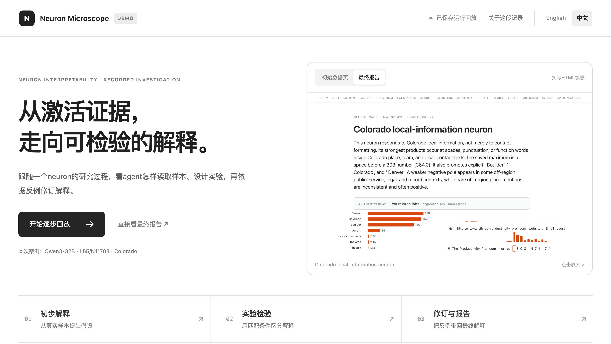
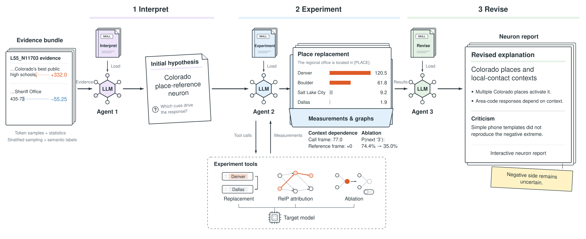

<p align="center">
  
</p>

<h1 align="center">
  Neuron Microscope<br>
  <sub>🔬 用 agent 复现 AlreadyClean</sub>
</h1>

<p align="center">
  <a href="docs/method.md"></a>
  <a href="skills/README.md"></a>
  <a href="docs/reports.md"></a>
  <a href="https://neuron-microscope-pipeline.tangysiren10.chatgpt.site/?lang=zh"></a>
  <a href="#quick-start"></a>
</p>

<p align="center"><a href="README.md">English</a> · <b>简体中文</b></p>

<p align="center">
  <a href="#overview">📖 概览</a> ·
  <a href="#live-demo">▶ Live Demo</a> ·
  <a href="#workflow">⚗️ 工作流程</a> ·
  <a href="#quick-start">🚀 快速开始</a> ·
  <a href="#reproduction-results">🧪 复现结果</a> ·
  <a href="#documentation">📚 文档</a>
</p>

## 📖 项目概览 <a id="overview"></a>

我们复现了 [AlreadyClean](https://already-clean.goodfire.com/) 的主要神经元分析与报告生成功能，并通过独立实验考察原博客的发现能否复现。我们通过实验观察到 **【主要发现】**，并得出 **【复现结论】**。详细实验与分析见下文的[复现结果](#reproduction-results)。

我们同时开源了完整的三阶段 pipeline，用于研究 dense Qwen3 模型的原生 MLP 神经元。流程覆盖证据整理、初步解释、实验设计与执行、解释修订和交互式 HTML 报告生成，并增加了 **【扩展功能】**，供社区使用和开展进一步研究。

后续，我们计划 **【后续计划】**。欢迎大家提供测试结果与反馈，共同改进神经元解释流程。

## ▶ Live Demo <a id="live-demo"></a>

**[浏览神经元报告 →](https://neuron-microscope-papers.tangysiren10.chatgpt.site/)** · **[查看流程演示 →](https://neuron-microscope-pipeline.tangysiren10.chatgpt.site/?lang=zh)**

报告站收录 20 份交互式神经元报告，有参考页面的报告支持左右对照。双语流程演示展示一次 Colorado neuron 研究记录，从证据整理走完三个 agent 阶段，包含 Prompt 节选、实验测量和保存的报告。两个网站均可公开访问。

[](https://neuron-microscope-pipeline.tangysiren10.chatgpt.site/?lang=zh)

本地预览方法和记录说明见[演示指南](docs/live-demo_zh.md)。

## ⚗️ 工作流程 <a id="workflow"></a>



1. **准备证据**：从已有激活档案中按幅度区间抽取 token 位置，保留对应上下文，以及实测 gate、up 和乘积激活值。采样参数由 `settings.json` 配置。
2. **初步解释与打标**：第一个独立容器加载 `skills/interpret/`，读取目标 neuron 的初始 HTML 和结构化证据，生成初步解释与分桶规则：正向、负向各最多三组，加一个 No visible cue 组。随后由固定工具根据这些规则逐样本打标，打标时隐藏待评样本的实测响应。代码将标签与实测值对应，用于绘图和修订；Activation spectrum 与 Inside the neuron 中的同一样本复用同一标签。
3. **实验**：第二个独立容器装 experiment skill；agent 设计实验，固定工具在宿主机完成替换、搜索、消融、RelP 归因及其他测量。
4. **修订**：第三个独立容器加载 `skills/revise/`，结合实验测量、初步标签与实测响应，修订解释、Criticism 和图注。固定代码生成 HTML 与费用章节。
5. **发布**：若提供对应原博客的本地快照，发布工具自动加入左右分屏、版块对齐和同步滚动。官方内容只加入展示页，不进入研究 agent 的输入。

公开报告采用500点采样配置。仓库目前默认最多抽取256个 scan 点；复现某份报告时，应使用该报告保存的配置。

**Clusters** 按语义组织已测量的样本。原始 NMF routes 描述归因模式，一个语义组可以跨越多条 route。各组的样本数、归因贡献占比和上游汇总由实测数据计算。

## 🚀 快速开始 <a id="quick-start"></a>

### 1. 在本地体验报告渲染

```bash
git clone https://github.com/RUC-TrustworthyAI/Neuron-Microscope.git
cd Neuron-Microscope
python3 -m venv .venv
source .venv/bin/activate
python -m pip install -r requirements/cpu.txt
python examples/demo.py --output runs/demo
python -m http.server 8000 --directory runs/demo
```

打开 **http://localhost:8000/** 查看演示。

演示使用代码生成的合成数据，仅检查页面功能，不是实验结果。它不需要 API、Docker 或模型，也可以在 macOS 上运行。

### 2. 配置真实实验

完整流程需要 Linux、Bash 4+、Docker、Python 3.10+、本地 dense-Qwen3 权重、已有激活和初始报告包，以及 DeepSeek API 凭证。默认 DeepSeek high。GPU 只承担目标模型的测量，四卡共同承载一份模型。

```bash
python -m pip install -r requirements/gpu.txt
# 安装与 NVIDIA 驱动匹配的 CUDA wheel。
python -m pip install torch==2.7.1 --index-url https://download.pytorch.org/whl/cu118
docker build -t neuron-microscope:local .
cp settings.json settings.local.json
```

修改 `settings.local.json` 中的 `paths.reports`、`paths.activations`、`paths.model`、`paths.state` 和 `gpu_groups`。可选 `paths.references` 放 `Lx_Ny.html` 原博客快照。相对路径以配置文件所在目录为基准。报告包及激活格式见 [docs/data.md](docs/data.md)。

在宿主机环境中提供 `DEEPSEEK_API_KEY`，或通过 `NEURON_PAPER_API_KEY_FILE` 指向本地密钥文件。不要把密钥写进配置或 Git。

### 3. 运行并查看

```bash
NEURON_PAPER_BUDGET_USD=5 ./run.sh prepare \
  --settings settings.local.json --output runs/example --neurons L55_N11703
./run.sh execute --run runs/example
./run.sh publish --run runs/example --neuron L55_N11703 --output results/example
python -m http.server 8000 --directory results/example
```

打开 **http://localhost:8000/**。示例 neuron 需替换为自己的数据中存在的编号。

- `prepare`：冻结代码和配置，不启动 LLM 或模型实验。
- `execute`：按快照执行准备和三阶段流程。
- `publish`：保留生成的科学内容，加入统一显示与可选对比功能。
- 默认整批 API 上限 2 美元；示例设为 5 美元。设 `unlimited` 可取消上限。费用是配置单价计算的估算，不是账户账单。
- `--neurons` 后可列多个 neuron。默认前一个第二阶段结束后才启动下一个，第三阶段可与下一个第一阶段重叠。
- 完整请求、输出、测量、费用和耗时保存在 `runs/`，可按 neuron 和阶段查看。

更多续跑、单阶段和复用测量操作见 [运行说明](docs/running.md)。展示窗口只影响页面文本：

- **Exemplars 与 Clusters**：默认折叠预览显示圈定 token 及其之前最多32个 token；点击 **Show full context** 展开保存的上下文。
- **Activation spectrum**：从首个高亮激活前最多128个 token 开始展示，并保留已有后文。若没有 token 达到高亮阈值，则以圈定位置为锚点。

测量使用的输入前缀和评分位置保持不变。

## 🧪 复现结果 <a id="reproduction-results"></a>

【主要对比图：原博客与本项目的复现结果】

- **主要发现：**【主要发现及对应实验】
- **复现结论：**【原博客的哪些发现已复现、部分复现或未能复现】

## 📚 文档导航 <a id="documentation"></a>

| 文档 | 解决什么问题 |
|---|---|
| [运行说明](docs/running.md) | 安装依赖，配置 GPU、认证，启动或继续一批实验 |
| [输入数据](docs/data.md) | 准备激活档案和目标报告数据 |
| [方法与实现](docs/method.md) | 从流程找到代码，了解各类测量的口径 |
| [报告指南](docs/reports.md) | 查找某张图或某个章节的数据来源和生成阶段 |
| [开发说明](docs/development.md) | 运行 CPU 软件测试与离线演示 |

<details>
<summary><strong>仓库目录</strong></summary>

```text
run.sh                 容器启动、排队与阶段交接
settings.json          科学参数默认值及可配置的宿主路径
Dockerfile             Agent 镜像与固定版本的 harness
skills/
  interpret/           初步解释
  experiment/          实验设计与工具调用
  revise/              修订、Criticism 和图注
tools/                 宿主证据读取、测量、渲染与费用记录
analysis/              从已有激活生成初始报告和统计表
examples/demo.py       离线合成报告示例
assets/                项目头图、流程图和配图
tests/                 CPU 软件样例和微型随机模型测试
requirements/          CPU、GPU 宿主及测试依赖
docs/                  环境、数据、方法与报告指南
```

</details>

## 🙏 致谢 <a id="acknowledgements"></a>

报告结构参考 Goodfire 的 [Neural Networks Are Already Clean](https://already-clean.goodfire.com/)，RelP 适配参考 [TransluceAI/circuits](https://github.com/TransluceAI/circuits)，agent 执行使用 [DeepSeek Harness](https://github.com/deepseek-ai/deepseek-harness)。

## 📄 许可 <a id="license"></a>

项目原创代码使用 [MIT License](LICENSE)。
