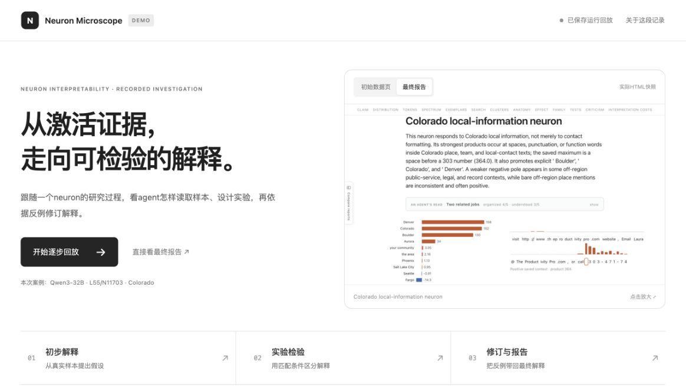

# Live Demo

**Deployment pending.** The demo is ready for local preview. This repository remains private; GitHub Pages can be enabled after the organization upgrades to a plan that supports Pages for private repositories.

## Preview locally

From the repository root:

```bash
python3 -m http.server 8000 --bind 127.0.0.1 --directory website
```

Open **http://127.0.0.1:8000/** in a current Chrome, Edge, Firefox or Safari browser. The demo uses static HTML, CSS and JavaScript. It needs no API key, model, GPU, Docker or Python packages.



## What the demo shows

Follow a recorded investigation of Qwen3-32B neuron **L55/N11703**, from its initial evidence page through interpretation, experiments, revision and the final interactive report. Each step contains an explanation, saved task and skill instructions, selected prompt examples, key operations, and corresponding artifacts. Screenshots can be enlarged; saved reports retain their plots, hover details and folding controls.

The recording includes an interrupted experiment stage, reuse of an earlier completed measurement stage, and a later labeling refresh. These events are shown in sequence. It reflects the pipeline version used for that recording.

The demo includes selected excerpts and report resources. Complete API request/response logs, credentials, model weights and activation archives stay outside this website. Scientific prose, displayed measurements and sample contexts are preserved by the exporter. The report resources omit local provenance paths and a duplicate example collection, and are compressed for static delivery. They load in the browser with `DecompressionStream`.

## Enable GitHub Pages later

After the organization has an eligible plan:

1. Open **Settings → Pages** and select **GitHub Actions** as the source.
2. Open **Actions → Publish live demo → Run workflow**, choose `main`, and run it.
3. Once deployment succeeds, use the URL shown in the `github-pages` deployment and update the README demo links to that URL.

The workflow is manual. Committing demo changes does not trigger a deployment.

## Refresh the recorded case

To export another prepared local recording:

```bash
python3 examples/export_live_demo.py --source /path/to/local-recording
```

This regenerates the curated files under `website/content/` and compressed report resources under `website/reports/`. The website interface and screenshot selection are maintained separately. The command reads saved material and performs no API calls or model runs.

---

## 中文说明

**待部署。** 演示代码已准备，可用上方命令在本地预览。主仓库保持私有，组织套餐升级后再启用 GitHub Pages，并手动运行 **Publish live demo**。

演示按步骤展示一次 Colorado neuron 的解释过程，包括初始页面、阶段指令、Prompt 节选、关键操作、实验与最终交互报告。当次运行中的中断、测量复用和后续刷新也有说明。页面使用保存的静态资源，打开演示不会启动实验或 API 请求。
