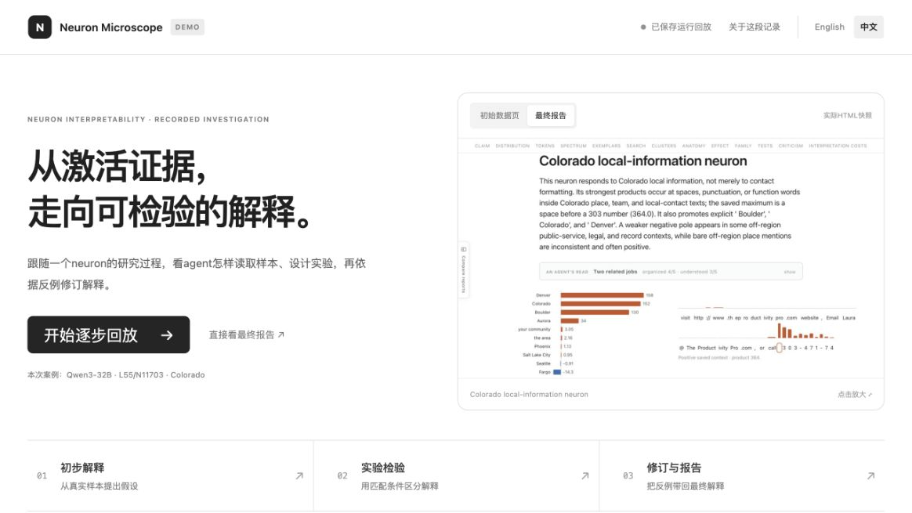

# Live Demo

[English](live-demo.md) · **简体中文**

**待部署。** 演示已可在本地预览。仓库保持私有，组织套餐升级后再启用 GitHub Pages。

## 本地预览

在仓库根目录运行：

```bash
python3 -m http.server 8000 --bind 127.0.0.1 --directory website
```

用新版 Chrome、Edge、Firefox 或 Safari 打开 **http://127.0.0.1:8000/?lang=zh** 查看中文版。网站默认显示英语，英语入口为 **http://127.0.0.1:8000/?lang=en**。右上角可切换语言，切换时保留当前步骤。

演示使用静态 HTML、CSS 和 JavaScript，无需 API key、模型、GPU、Docker 或额外 Python 包。



## 演示内容

跟随 Qwen3-32B 的 **L55/N11703** neuron，从初始证据页走完初步解释、实验、修订，最后查看交互报告。每一步都有讲解、保存的任务与 skill 指令、Prompt 节选、关键操作和相应产物。截图可以放大；交互报告保留图表、悬停详情和折叠功能。

界面和流程讲解支持中英双语。保存的 Prompt、样本上下文、测量和科学报告保留原文。

这次记录包含第二阶段中断、复用较早完成的测量，以及后续打标刷新。演示按发生顺序展示这些步骤，并保留当时版本的行为。

网站包含节选和报告所需资源。完整 API 请求与响应日志、凭证、模型权重和激活存档留在本地。导出程序保留科学文字、展示数值和样本上下文，去掉本机来源路径及重复的样本集合，并压缩报告资源；浏览器通过 `DecompressionStream` 加载报告。

## 升级套餐后上线

1. 打开 **Settings → Pages**，选择 **GitHub Actions** 作为发布来源。
2. 打开 **Actions → Publish live demo → Run workflow**，选择 `main` 并运行。
3. 部署成功后，取 `github-pages` 中显示的网址。英文 README 链接附加 `?lang=en`，中文 README 链接附加 `?lang=zh`。

发布配置只支持手动触发，提交代码不会自动部署。

## 更新演示案例

准备好本地记录后运行：

```bash
python3 examples/export_live_demo.py --source /path/to/local-recording
```

该命令重新生成 `website/content/` 中的节选，以及 `website/reports/` 中的压缩报告。界面与截图单独维护。导出只读取保存的材料，不发起 API 请求或模型运行。
