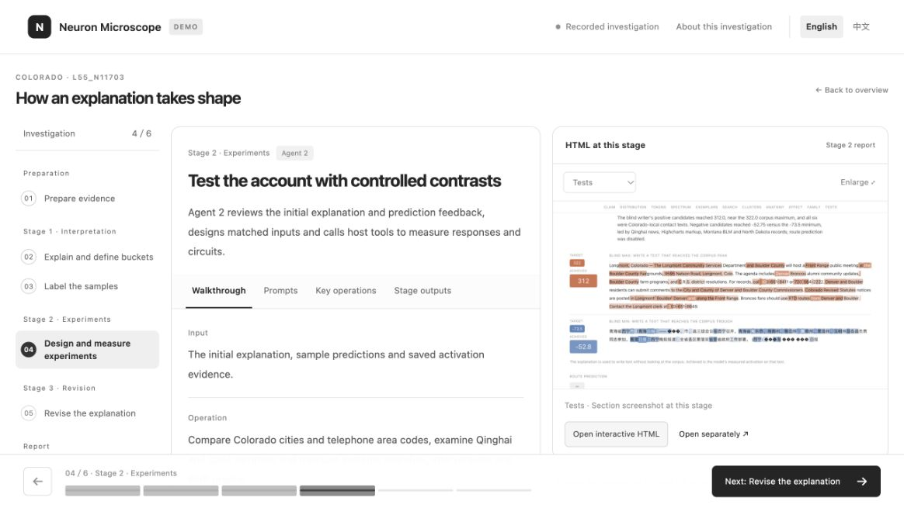

# Recorded language model investigation

**English** · [简体中文](walkthrough_zh.md)

**[Neuron reports](https://ruc-trustworthyai.github.io/Neuron-Microscope-Pages/reasoning-mix-100m-50/)** · **[Language model walkthrough](https://ruc-trustworthyai.github.io/Neuron-Microscope-Pages/walkthrough/language/?lang=en)**

The walkthrough follows **Qwen3-32B L55/N11703 on Reasoning Mix 100M**. It records evidence preparation, an initial explanation, two revisions, three blind-labeling passes, explanation selection, experiments and report review. The [workflow guide](workflow.md) describes the corresponding code and configuration.

## Preview locally

From the repository root:

```bash
python3 -m http.server 8000 --bind 127.0.0.1 --directory website
```

Open <http://127.0.0.1:8000/walkthrough/language/?lang=en> in a current browser. Select Chinese with the language switch or `?lang=zh`; switching languages retains the current step.



## Read the evidence

The six steps cover evidence preparation, initial explanation, blind labeling and refinement, selection and freezing, text construction and measurement, and attribution and report review. Each step shows saved prompts, structured outputs and the corresponding measurements. The interface and explanations are bilingual; prompts, sample contexts and measured results retain their source content.

All three explanation versions use the same 500 sampled positions. The walkthrough displays each version's rules, blind labels, coverage and directional accuracy. This run selected the first revision, whose report contains 498 labeled positions. The selected explanation and its labels are frozen before experiments. Search uses measurement feedback; the Blind writer receives the frozen explanation. Later analysis and review assess the experimental results.

The recording is stored in `website/walkthrough/language/`. Report resources are compressed and loaded through the browser's `DecompressionStream`.

## Export another completed run

Copy the walkthrough interface to a new directory, then export a completed run into it:

```bash
python3 -c "import shutil; shutil.copytree('website/walkthrough/language', 'runs/walkthrough')"
python3 language/examples/export_walkthrough.py --run runs/example --output runs/walkthrough
python3 -m http.server 8000 --bind 127.0.0.1 --directory runs/walkthrough
```

Replace `runs/example` with the completed run's directory, then open <http://127.0.0.1:8000/?lang=en>. The exporter rebuilds `content/`, `reports/` and `screenshots/` from saved artifacts while keeping the copied HTML, JavaScript and CSS. It exports prompt and input excerpts, structured responses, round comparisons, measurements and compressed reports.

## Publish with GitHub Pages

For a repository with GitHub Pages available:

1. In **Settings → Pages**, choose **GitHub Actions** as the source.
2. Open **Actions → Publish documentation site → Run workflow** and select the branch containing the website.
3. Open the deployment URL followed by `walkthrough/language/?lang=en` or `walkthrough/language/?lang=zh`.

The manually triggered workflow publishes `website/`. The neuron-report directory and vision viewer have their own export and hosting entries.
