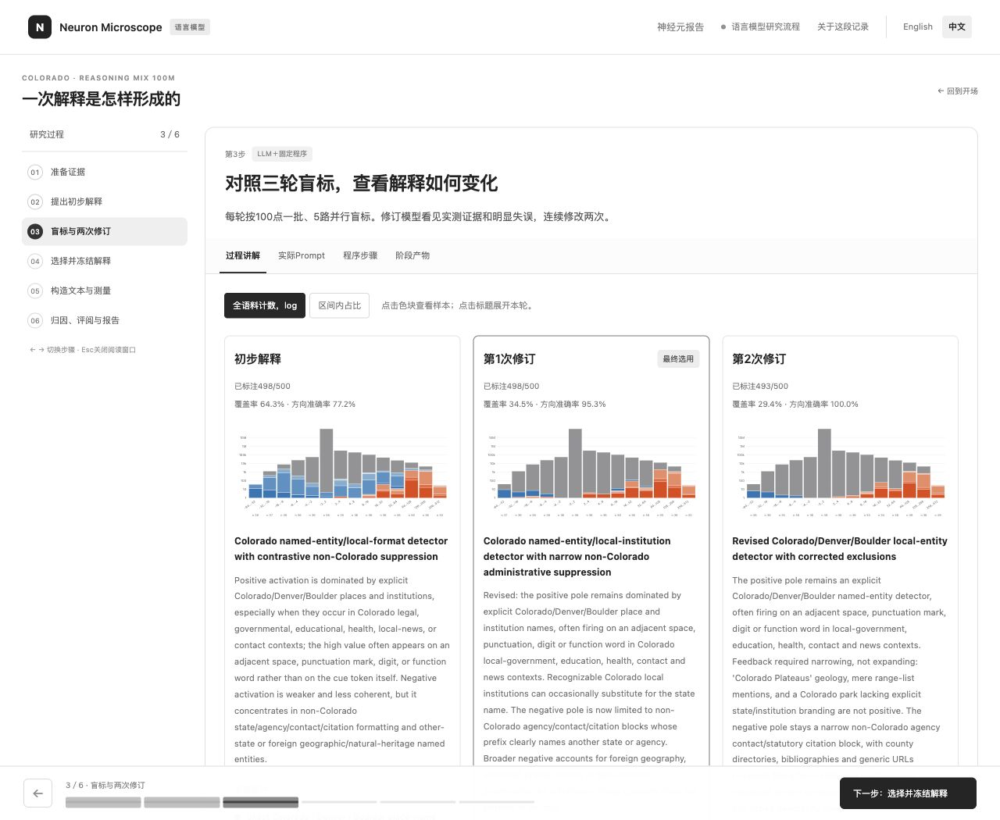

# 语言模型研究过程记录

[English](walkthrough.md) · **简体中文**

**[神经元报告](https://ruc-trustworthyai.github.io/Neuron-Microscope-Pages/reasoning-mix-100m-50/)** · **[语言模型流程回放](https://ruc-trustworthyai.github.io/Neuron-Microscope-Pages/walkthrough/language/?lang=zh)**

这份记录展示了 **Qwen3-32B L55/N11703 在 Reasoning Mix 100M 上的研究过程**，包括证据准备、初步解释、两次修订、三轮盲标、解释选择、实验和报告评阅。[流程说明](workflow.md)介绍了对应代码和配置。

## 本地预览

从仓库根目录运行：

```bash
python3 -m http.server 8000 --bind 127.0.0.1 --directory website
```

使用新版浏览器打开 <http://127.0.0.1:8000/walkthrough/language/?lang=zh>。通过语言按钮或 `?lang=en` 切换语言时，页面会保留当前步骤。



## 阅读证据

六个步骤依次展示证据准备、初步解释、盲标与修订、选择与冻结、构造文本与测量，以及归因和报告评阅。每一步都展示保存的提示词、结构化输出和对应测量。界面与讲解支持中英双语，提示词、样本上下文和测量结果保留原文。

三个解释版本使用同一批 500 个采样位置。页面展示各版规则、盲标结果、覆盖率和方向准确率。本次运行选用了第一次修订的解释，对应报告包含 498 个已标注位置。程序在实验前冻结选定的解释及其标签。随后，Search 根据测量反馈继续搜索，Blind 写作模型根据冻结的解释构造文本，分析模型与独立评阅模型再评估实验结果。

记录位于 `website/walkthrough/language/`。报告资源经过压缩，由浏览器通过 `DecompressionStream` 加载。

## 导出另一份已完成的研究

先将回放界面复制到新目录，再将已完成的运行导出到该目录：

```bash
python3 -c "import shutil; shutil.copytree('website/walkthrough/language', 'runs/walkthrough')"
python3 language/examples/export_walkthrough.py --run runs/example --output runs/walkthrough
python3 -m http.server 8000 --bind 127.0.0.1 --directory runs/walkthrough
```

将 `runs/example` 换成已完成运行的目录，然后打开 <http://127.0.0.1:8000/?lang=zh>。导出程序根据保存的产物重新生成 `content/` 和 `reports/`，并清除复制的 `screenshots/` 目录。复制的 HTML、JavaScript 和 CSS 会保留。导出的内容包括提示词与输入节选、结构化响应、各轮对比、测量和压缩报告。所需截图请单独截取。

## 通过 GitHub Pages 发布

仓库具备 GitHub Pages 使用权限时：

1. 在 **Settings → Pages** 中选择 **GitHub Actions**。
2. 打开 **Actions → Publish documentation site → Run workflow**，选择包含网站内容的分支。
3. 在部署网址后加上 `walkthrough/language/?lang=en` 或 `walkthrough/language/?lang=zh`。

工作流手动发布 `website/`。神经元报告目录与视觉展示站各有对应的导出和托管入口。
