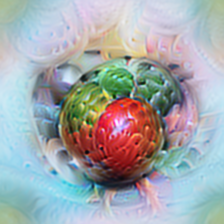
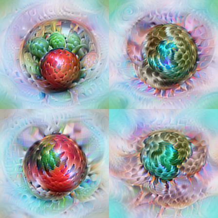
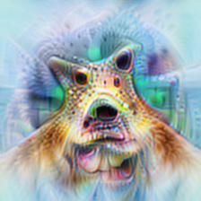

<h1 align="center">Neuron Microscope · Vision</h1>

<p align="center">
  <strong>Inspect what activates an InceptionV1 neuron, then compare the visual evidence.</strong>
</p>

<p align="center">
  <a href="../README.md">Project home</a> ·
  <a href="README_zh.md">中文</a> ·
  <a href="docs/gallery.md">Visual comparisons</a> ·
  <a href="#installation-and-usage">Install and run</a>
</p>

This module implements feature visualization and natural-image retrieval for **InceptionV1 / Lucent Inception5h**. You can choose a channel, optimize images in five modes, retrieve natural examples and heatmaps, and export an interactive viewer with AlreadyClean reference links.

The catalog covers **12 layers and 5,804 channels**. This is the target catalog; each exported viewer records which results are actually available. The [LLM investigation workflow](../docs/workflow.md) has a separate environment and entry point.

## Visual comparisons

[Browse all bundled comparisons →](docs/gallery.md)

<table align="center">
  <tr><th>Positive</th><th>Diversity</th><th>Negative</th></tr>
  <tr>
    <td><a href="docs/assets/mixed4c_260/positive.png"></a></td>
    <td><a href="docs/assets/mixed4c_260/diversity.png"></a></td>
    <td><a href="docs/assets/mixed4c_260/negative.png"></a></td>
  </tr>
</table>

**mixed4c:260 · configuration A · 224 × 224 · 1,024 steps · seed 0.** These are saved optimization outputs. The [gallery](docs/gallery.md) shows all five modes beside the reference images for four channels, with [settings and measured scores](docs/assets/provenance.json). One member of the mixed4c:477 Diversity result has near-zero activation; the gallery retains it.

The upstream project also links a [hosted interactive viewer](https://ziheng-inception-microscope-a.tart-olm-9383.chatgpt.site/?layer=mixed4c&neuron=260&compare=1). The bundled comparisons above can be read directly in this repository.

## How the vision workflow works

1. **Select the target.** Load the pinned Inception5h weights and choose a layer and channel. The target definition records its branch, spatial aggregation and pre/post-ReLU activation.
2. **Retrieve natural examples.** Scan 50 images per ImageNet class, for 50,000 training images. Save response extrema, examples and activation heatmaps, then build anchors for the guided objectives.
3. **Optimize images.** Optimize Fourier coefficients using the A configuration, fitted color statistics, frequency and blur schedules, and a Gaussian-weighted activation objective.
4. **Inspect and export.** Export completed runs, optional natural examples, receptive-field crops and a verified reference catalog into an HTML viewer. Inspect configuration, scores and checkpoints alongside the images.

| View | Activation objective | Additional constraint |
| --- | --- | --- |
| **Positive** | Maximize post-ReLU activation. | Base image parameterization and color prior. |
| **Path-guided +** | Maximize post-ReLU activation. | Align with positive natural-example activation vectors during the first 64 steps. |
| **Diversity** | Maximize post-ReLU activation for four images. | Penalize similarity within the group using the previous layer. |
| **Negative** | Minimize signed pre-ReLU activation. | Base image parameterization and color prior. |
| **Path-guided −** | Minimize signed pre-ReLU activation. | Align with negative natural-example activation vectors during the first 64 steps. |

The path representation is a pooled activation-vector proxy. Its definition and the fitted color prior are described in the [method guide](docs/methodology.md).

## Installation and usage

### 1. Install the module

Use **Python 3.11+** and a separate environment. Install a CUDA-compatible PyTorch and torchvision build for GPU optimization, then install the package:

```bash
git clone --branch hr-vision-integration https://github.com/RUC-TrustworthyAI/Neuron-Microscope.git
cd Neuron-Microscope/vision
python3 -m venv .venv
source .venv/bin/activate
python -m pip install -e './vision-repro[dev]'
vision-microscope catalog
```

The catalog command reads no model weights and needs no GPU. The package declares its dependency ranges in [pyproject.toml](vision-repro/pyproject.toml).

### 2. Provision the model

Follow [model setup](source/inceptionv1/README.md) to place the pinned Lucent checkout and weights under `source/inceptionv1/`. Existing assets can be reused through `VNI_MODEL_DIR`.

```bash
vision-microscope doctor --model-dir source/inceptionv1
```

The manifest records the source revision, weight digest and `RGB * 255 - 117` preprocessing. Weights and ImageNet data are acquired separately.

### 3. Optimize a channel and export its viewer

From the `vision/` directory:

```bash
vision-microscope optimize --layer mixed4c --neurons 260 \
  --variant positive --steps 1024 \
  --output vision-repro/outputs/mixed4c_260_positive
vision-microscope export \
  --runs vision-repro/outputs/mixed4c_260_positive \
  --output vision-repro/outputs/viewer
python -m http.server 8766 --directory vision-repro/outputs/viewer
```

Open <http://localhost:8766/?layer=mixed4c&neuron=260>. Use a fresh output directory for a changed configuration or viewer export. The [running guide](docs/reproduction.md) covers the ImageNet scan, anchors, all five modes, batch generation and resume.

To include verified reference images, pass `--reference-catalog` in the [documented format](docs/data-format.md#静态导出). Natural samples use `--sample-run`; receptive-field crops additionally use `--rf-snapshot`. Export without these inputs contains the available optimization results and placeholders for missing material.

## Interpreting the results

- **Checkpoint scope.** These results use the historical Lucent Inception5h conversion. Goodfire's retrained checkpoint is a different model, so matching layer/channel names and visual appearance do not establish semantic equivalence.
- **Signed targets.** Positive scores are post-ReLU; negative scores are pre-ReLU. A zero post-ReLU minimum does not measure signed suppression.
- **Scoring and display.** Optimization uses normalized Gaussian-weighted scores; natural examples are ranked by spatial extrema. Heatmaps are normalized per image and display layer activations.
- **Image priors.** Configuration A includes mean-color and peripheral-color constraints. These affect image appearance and must be considered when interpreting colors.

## Methods and developer guides

| Guide | Use it to… |
| --- | --- |
| [Model setup](source/inceptionv1/README.md) | Provision the exact source, checkpoint and preprocessing. |
| [Running](docs/reproduction.md) | Scan data, build anchors, optimize batches and resume work. |
| [Method](docs/methodology.md) | Inspect the parameterization, losses and target definitions. |
| [Data format](docs/data-format.md) | Read run records, scores, checkpoints and viewer assets. |
| [Hosting](docs/hosting.md) | Serve a static export or use the optional object-storage service. |
| [Development](docs/development.md) | Run CPU tests and check the viewer and media service. |

The Python package is in `vision-repro/src/vision_repro/`; browser assets are in its `web/microscope/` directory. Generated runs belong under `vision-repro/outputs/` and stay outside Git. Full model assets and ImageNet archives are also excluded.

## Sources and attribution

The vision module comes from [Vision-Neuron-Microscope, branch merge](https://github.com/RUC-TrustworthyAI/Vision-Neuron-Microscope/tree/72ea2d06094473d2d4368eb79338f5a428ffd636/vision), maintained by the upstream contributors. It builds on [AlreadyClean](https://already-clean.goodfire.com/), [Lucent](https://github.com/greentfrapp/lucent) and [Lucid](https://github.com/tensorflow/lucid). See [source and licensing terms](THIRD_PARTY_NOTICES.md).
