<h1 align="center">
  Vision Neuron Microscope<br>
  <sub>🔬 Exploring vision neurons with feature visualization</sub>
</h1>

<p align="center">
  <a href="source/inceptionv1/README.md"></a>
  <a href="#overview"></a>
  <a href="#reproduction-results"></a>
  <a href="https://vision-neuron-microscope.tart-olm-9383.chatgpt.site/?layer=mixed4c&amp;neuron=477&amp;compare=1"></a>
</p>
<p align="center"><b>English</b> · <a href="README_zh.md">简体中文</a></p>
<p align="center">
  <a href="#overview">📖 Overview</a> ·
  <a href="#workflow">⚗️ How It Works</a> ·
  <a href="#quick-start">🚀 Quick Start</a> ·
  <a href="#reproduction-results">🧪 Results</a> ·
  <a href="#documentation">📚 Documentation</a>
</p>

## 📖 Overview <a id="overview"></a>

Vision Neuron Microscope explores the visual features learned by InceptionV1. Inspired by [AlreadyClean](https://already-clean.goodfire.com/), it combines optimized images, natural-image retrieval, activation heatmaps, and side-by-side comparisons in one viewer.

The catalog covers **12 layers and 5,804 neurons**, with **Positive, Path-guided +, Diversity, Negative, and Path-guided −**. The default **A** configuration uses **224 × 224 inputs and 1,024 optimization steps**.

**[Open the interactive microscope ↗](https://ziheng-inception-microscope-a.tart-olm-9383.chatgpt.site/?layer=mixed4c&neuron=447&compare=1)**

## ⚗️ How It Works <a id="workflow"></a>

1. **Choose a neuron.** Load the pinned Lucent Inception5h model and select a layer and channel.
2. **Prepare natural examples.** Scan 50,000 ImageNet training images to retrieve Top 16, Additional Examples, activation heatmaps, and path anchors. Display the strongest locations with branch-specific receptive-field crops.
3. **Optimize images.** Optimize Fourier coefficients with a fitted color basis, progressive frequency unlocking, blur annealing, and a Gaussian-weighted activation objective.
4. **Compare results.** Export an HTML viewer with five visualization modes, optimization checkpoints, and Nick / Goodfire references.

| Mode | Objective |
|---|---|
| Positive | Maximize post-ReLU activation |
| Path-guided + | Positive with early natural-example path guidance |
| Diversity | Four positive images with a diversity objective |
| Negative | Minimize signed pre-ReLU activation |
| Path-guided − | Negative with early natural-example path guidance |

Path guidance uses pooled activation-vector anchors. See the [method guide](docs/methodology.md) for losses, color priors, and target definitions.

## 🚀 Quick Start <a id="quick-start"></a>

### 1. Install and prepare the model

Use Python 3.11+ in a dedicated environment with CUDA-compatible PyTorch.

```bash
git clone --branch hr-language-refactor https://github.com/RUC-TrustworthyAI/Neuron-Microscope.git
cd Neuron-Microscope/vision
python -m pip install -e './vision-repro[dev]'
```

Follow [model setup](source/inceptionv1/README.md) to place Lucent and the weights in `source/inceptionv1/`, then check:

```bash
vision-microscope doctor --model-dir source/inceptionv1
vision-microscope catalog
```

For an existing model directory elsewhere, set `VNI_MODEL_DIR` to its absolute path.

### 2. Generate and view a result

```bash
vision-microscope optimize --layer mixed4c --neurons 447 \
  --variant positive --steps 1024 \
  --output vision-repro/outputs/mixed4c_447_positive
vision-microscope export \
  --runs vision-repro/outputs/mixed4c_447_positive \
  --output vision-repro/outputs/viewer
python -m http.server 8766 --directory vision-repro/outputs/viewer
```

Open [localhost:8766](http://localhost:8766/?layer=mixed4c&neuron=447&compare=1). Use a new output directory for each configuration.

### 3. Generate all five modes

The [running guide](docs/reproduction.md) covers ImageNet scanning, anchor preparation, all-neuron queues, concurrency, and resume. Path-guided modes and Diversity use anchors from the natural-image scan. Export accepts `--sample-run` for examples and heatmaps, `--rf-snapshot` for receptive-field crops, and `--reference-catalog` for official comparisons. Large galleries can use the optional [R2 media service](docs/hosting.md).

## 🧪 Reproduction Results <a id="reproduction-results"></a>

Four neurons, five modes. **Ours: A · 224 × 224 · 1,024 steps · default seed 0.** Diversity shows four images. Click an image to enlarge it.

### mixed4c · 477

| | Positive | Path-guided + | Diversity | Negative | Path-guided − |
|---|---|---|---|---|---|
| Nick | <a href="https://already-clean.goodfire.com/microscope/inceptionv1/fv/positive/mixed4c/477.png"></a> | <a href="https://already-clean.goodfire.com/microscope/inceptionv1/fv/path_positive/mixed4c/477.png"></a> | <a href="https://already-clean.goodfire.com/microscope/inceptionv1/fv/diversity/mixed4c/477.png"></a> | <a href="https://already-clean.goodfire.com/microscope/inceptionv1/fv/negative/mixed4c/477.png"></a> | <a href="https://already-clean.goodfire.com/microscope/inceptionv1/fv/path_negative/mixed4c/477.png"></a> |
| Ours | <a href="docs/assets/mixed4c_477/positive.png">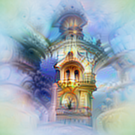</a> | <a href="docs/assets/mixed4c_477/path_positive.png"></a> | <a href="docs/assets/mixed4c_477/diversity.png">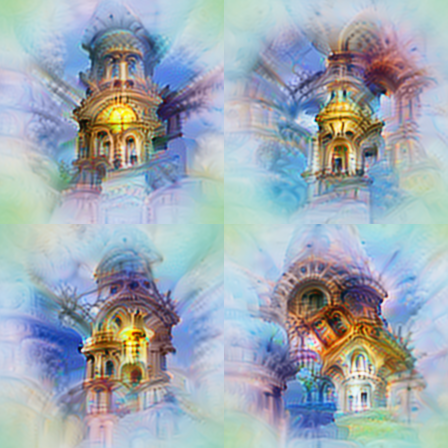</a> | <a href="docs/assets/mixed4c_477/negative.png">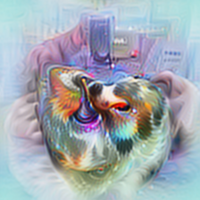</a> | <a href="docs/assets/mixed4c_477/path_negative.png">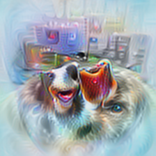</a> |

477 Diversity: the lower-left image uses seed 1 (post-ReLU activation 8,031.94); the other three retain seed 0.

### mixed4c · 260

| | Positive | Path-guided + | Diversity | Negative | Path-guided − |
|---|---|---|---|---|---|
| Nick | <a href="https://already-clean.goodfire.com/microscope/inceptionv1/fv/positive/mixed4c/260.png"></a> | <a href="https://already-clean.goodfire.com/microscope/inceptionv1/fv/path_positive/mixed4c/260.png"></a> | <a href="https://already-clean.goodfire.com/microscope/inceptionv1/fv/diversity/mixed4c/260.png"></a> | <a href="https://already-clean.goodfire.com/microscope/inceptionv1/fv/negative/mixed4c/260.png"></a> | <a href="https://already-clean.goodfire.com/microscope/inceptionv1/fv/path_negative/mixed4c/260.png"></a> |
| Ours | <a href="docs/assets/mixed4c_260/positive.png"></a> | <a href="docs/assets/mixed4c_260/path_positive.png">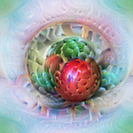</a> | <a href="docs/assets/mixed4c_260/diversity.png"></a> | <a href="docs/assets/mixed4c_260/negative.png"></a> | <a href="docs/assets/mixed4c_260/path_negative.png">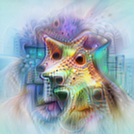</a> |

### mixed4c · 286

| | Positive | Path-guided + | Diversity | Negative | Path-guided − |
|---|---|---|---|---|---|
| Nick | <a href="https://already-clean.goodfire.com/microscope/inceptionv1/fv/positive/mixed4c/286.png"></a> | <a href="https://already-clean.goodfire.com/microscope/inceptionv1/fv/path_positive/mixed4c/286.png"></a> | <a href="https://already-clean.goodfire.com/microscope/inceptionv1/fv/diversity/mixed4c/286.png"></a> | <a href="https://already-clean.goodfire.com/microscope/inceptionv1/fv/negative/mixed4c/286.png"></a> | <a href="https://already-clean.goodfire.com/microscope/inceptionv1/fv/path_negative/mixed4c/286.png"></a> |
| Ours | <a href="docs/assets/mixed4c_286/positive.png">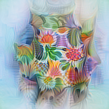</a> | <a href="docs/assets/mixed4c_286/path_positive.png">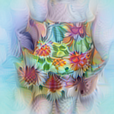</a> | <a href="docs/assets/mixed4c_286/diversity.png">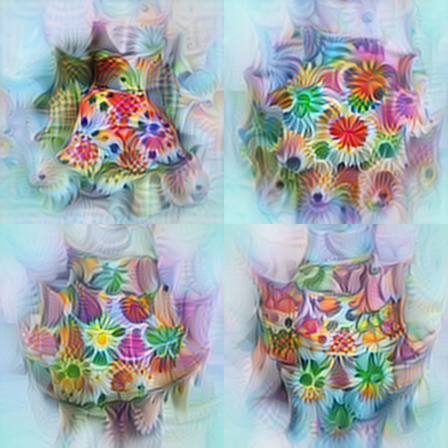</a> | <a href="docs/assets/mixed4c_286/negative.png">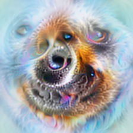</a> | <a href="docs/assets/mixed4c_286/path_negative.png">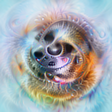</a> |

### mixed4c · 212

| | Positive | Path-guided + | Diversity | Negative | Path-guided − |
|---|---|---|---|---|---|
| Nick | <a href="https://already-clean.goodfire.com/microscope/inceptionv1/fv/positive/mixed4c/212.png"></a> | <a href="https://already-clean.goodfire.com/microscope/inceptionv1/fv/path_positive/mixed4c/212.png"></a> | <a href="https://already-clean.goodfire.com/microscope/inceptionv1/fv/diversity/mixed4c/212.png"></a> | <a href="https://already-clean.goodfire.com/microscope/inceptionv1/fv/negative/mixed4c/212.png"></a> | <a href="https://already-clean.goodfire.com/microscope/inceptionv1/fv/path_negative/mixed4c/212.png"></a> |
| Ours | <a href="docs/assets/mixed4c_212/positive.png">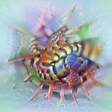</a> | <a href="docs/assets/mixed4c_212/path_positive.png">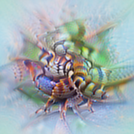</a> | <a href="docs/assets/mixed4c_212/diversity.png">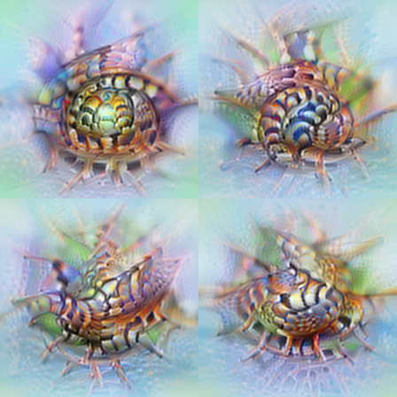</a> | <a href="docs/assets/mixed4c_212/negative.png">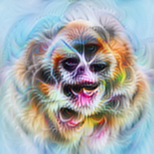</a> | <a href="docs/assets/mixed4c_212/path_negative.png">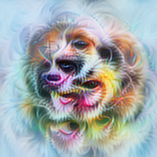</a> |

[Image settings and provenance](docs/assets/provenance.json) · [Original microscope](https://already-clean.goodfire.com/microscope/inceptionv1.html?layer=mixed4c&neuron=477)

## 📚 Documentation <a id="documentation"></a>

| Guide | Contents |
|---|---|
| [Model setup](source/inceptionv1/README.md) | Source revision, weights, and preprocessing |
| [Running](docs/reproduction.md) | Optimization, natural examples, batch generation, and export |
| [Method](docs/methodology.md) | Image parameterization and the five objectives |
| [Data format](docs/data-format.md) | Run records, checkpoints, and viewer assets |
| [Hosting](docs/hosting.md) | Immutable media snapshots, upload resume, and publication |
| [Validation](docs/validation.md) | Tests and GPU checks |

<details>
<summary><strong>Repository layout</strong></summary>

```text
vision-repro/
  src/vision_repro/     Optimization, retrieval, queue, and CLI
    defaults/          A configuration and fitted color statistics
    web/microscope/    HTML viewer
  tests/               Unit tests
  outputs/             Generated runs (not tracked)
source/inceptionv1/    Model manifest and setup
hosting/              Optional R2 media API and tests
docs/                 Guides and example figures
```

</details>

Run `pytest vision-repro/tests`, `node vision-repro/tests/test_viewer.mjs`, and `node hosting/test-media.mjs`.

## 🙏 Acknowledgements <a id="acknowledgements"></a>

This project builds on [Nick / Goodfire's AlreadyClean](https://already-clean.goodfire.com/), [Lucent](https://github.com/greentfrapp/lucent), and [Lucid](https://github.com/tensorflow/lucid). README structure follows [Neuron-Microscope](https://github.com/RUC-TrustworthyAI/Neuron-Microscope). See [sources and third-party terms](THIRD_PARTY_NOTICES.md).
