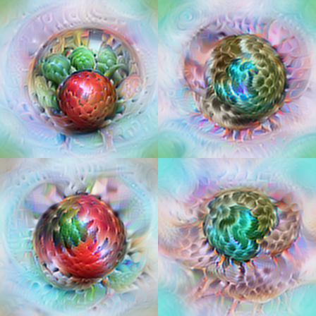
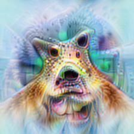

<h1 align="center">Neuron Microscope · Vision</h1>

<p align="center">
  <strong>查看哪些图像会激活 InceptionV1 神经元，再比较具体证据。</strong>
</p>

<p align="center">
  <a href="../README_zh.md">项目主页</a> ·
  <a href="README.md">English</a> ·
  <a href="docs/gallery.md">视觉对比</a> ·
  <a href="#installation-and-usage">安装与运行</a>
</p>

本模块实现 **InceptionV1／Lucent Inception5h** 的特征可视化与自然图像检索。用户可以选择通道，使用五种目标优化图像，查看自然样例和热图，并导出包含 AlreadyClean 参考链接的交互式网页。

本模块固定了 Lucent Inception5h 的源码版本与权重摘要。[AlreadyClean 参考站元数据](https://already-clean.goodfire.com/microscope/inceptionv1/meta.json)同样标注 Lucent 预训练权重；精确权重身份尚未核对。

目录覆盖 **12 层、5,804 个通道**。这是可选目标的目录，每次网页导出会记录实际已有的结果。[LLM 研究流程](../docs/workflow.md)使用独立环境和入口。

## 视觉对比 <a id="visual-comparisons"></a>

[浏览仓库中的完整对比 →](docs/gallery.md)

<table align="center">
  <tr><th>正向优化</th><th>多样性优化</th><th>负向优化</th></tr>
  <tr>
    <td><a href="docs/assets/mixed4c_260/positive.png"></a></td>
    <td><a href="docs/assets/mixed4c_260/diversity.png"></a></td>
    <td><a href="docs/assets/mixed4c_260/negative.png"></a></td>
  </tr>
</table>

**mixed4c:260 · A 配置 · 224 × 224 · 1,024 步 · seed 0。** 以上均为已保存的优化输出。[完整对比](docs/gallery.md)列出了四个通道的全部五种结果及原图，[参数和实测分数](docs/assets/provenance.json)可供核对。

上游还提供了[交互式展示站](https://ziheng-inception-microscope-a.tart-olm-9383.chatgpt.site/?layer=mixed4c&neuron=260&compare=1)。上面的对比图片可以直接在仓库中查看。

## 视觉模块如何运行 <a id="how-the-vision-workflow-works"></a>

1. **选择目标。** 加载固定版本的 Inception5h 权重，选定层和通道，记录其分支、空间聚合方式，以及 ReLU 前后的目标定义。
2. **检索自然样例。** 从 ImageNet 每类扫描 50 张，共 50,000 张训练图像。保存激活极值、样例和热图，再为引导目标建立锚点。
3. **优化图像。** 按 A 配置优化 Fourier 系数，使用拟合的颜色统计、频段与模糊调度，以及 Gaussian 加权的激活目标。
4. **检查并导出。** 将已完成的优化结果、可选自然样例、感受野裁剪和已核验的参考索引导出为 HTML，结合图像检查配置、分数和中间检查点。

| 视图 | 激活目标 | 附加约束 |
| --- | --- | --- |
| **Positive** | 最大化 ReLU 后的激活。 | 基础图像参数化与颜色先验。 |
| **Path-guided +** | 最大化 ReLU 后的激活。 | 前 64 步对齐正向自然样例的激活向量。 |
| **Diversity** | 为四张图最大化 ReLU 后的激活。 | 利用前一层惩罚组内相似性。 |
| **Negative** | 最小化 ReLU 前的有符号激活。 | 基础图像参数化与颜色先验。 |
| **Path-guided −** | 最小化 ReLU 前的有符号激活。 | 前 64 步对齐负向自然样例的激活向量。 |

这里的路径表示使用池化后的激活向量作为代理。[方法说明](docs/methodology_zh.md)给出了具体定义和颜色先验。

## 安装与使用 <a id="installation-and-usage"></a>

### 1. 安装模块

使用 **Python 3.11+** 和独立环境。GPU 运行与批量生成使用 Linux，需要先安装与 CUDA 兼容的 PyTorch 和 torchvision，再安装本模块：

```bash
git clone --branch hr-vision-integration https://github.com/RUC-TrustworthyAI/Neuron-Microscope.git
cd Neuron-Microscope/vision
python3 -m venv .venv
source .venv/bin/activate
python -m pip install -e './vision-repro[dev]'
vision-microscope catalog
```

目录命令无需模型权重或 GPU。[pyproject.toml](vision-repro/pyproject.toml)声明了依赖范围。

### 2. 准备模型

按[模型配置说明](source/inceptionv1/README.md)，将指定版本的 Lucent 和权重放到 `source/inceptionv1/`。已有资产可以通过 `VNI_MODEL_DIR` 复用。

```bash
vision-microscope doctor
```

模型清单记录了源码版本、权重摘要和 `RGB * 255 - 117` 预处理。权重与 ImageNet 数据需要单独获取。

### 3. 优化通道并导出网页

以下命令从 `vision/` 目录执行：

```bash
vision-microscope optimize --layer mixed4c --neurons 260 \
  --variant positive --steps 1024 \
  --output vision-repro/outputs/mixed4c_260_positive
vision-microscope export \
  --runs vision-repro/outputs/mixed4c_260_positive \
  --output vision-repro/outputs/viewer
python -m http.server 8766 --directory vision-repro/outputs/viewer
```

打开 <http://localhost:8766/?layer=mixed4c&neuron=260>。更改配置或重新导出网页时使用新目录。[运行指南](docs/reproduction_zh.md)还涵盖 ImageNet 扫描、锚点、五种目标、批量生成和续跑。

需要参考图时，按[数据格式](docs/data-format_zh.md#静态导出)提供 `--reference-catalog`。自然样例使用 `--sample-run`，感受野裁剪还需 `--rf-snapshot`。导出器仅显示已提供的结果，其余内容显示占位。

## 如何理解结果 <a id="interpreting-the-results"></a>

- **采样范围。** 本模块从按类别均衡抽取的 50,000 张图像中检索正负样例。参考站说明，正向样例来自 50,000 张，负向尾部则覆盖全部 1,281,167 张训练图像。两者可用于比较的样例范围有差异，具体见[方法说明](docs/methodology_zh.md#自然样例和可比性)。
- **有符号目标。** 正向分数来自 ReLU 后，负向分数来自 ReLU 前。ReLU 后的零值无法衡量负向抑制强度。
- **评分与显示。** 优化采用归一化 Gaussian 加权分数，自然样例按空间极值排序。热图逐图归一化，展示对应层的激活。
- **图像先验。** A 配置约束了整体与外围的平均颜色。理解图片颜色时，需要考虑这些约束对外观的影响。

## 方法与开发指南 <a id="methods-and-developer-guides"></a>

| 指南 | 用途 |
| --- | --- |
| [模型配置](source/inceptionv1/README.md) | 准备指定源码、权重和预处理。 |
| [运行](docs/reproduction_zh.md) | 扫描数据、建立锚点、优化批次并续跑。 |
| [方法](docs/methodology_zh.md) | 查看图像参数化、损失和目标定义。 |
| [数据格式](docs/data-format_zh.md) | 读取运行记录、分数、检查点和网页资产。 |
| [部署](docs/hosting.md) | 托管静态导出，或配置可选的对象存储服务。 |
| [开发](docs/development.md) | 运行 CPU 测试，检查网页与媒体服务。 |

Python 包位于 `vision-repro/src/vision_repro/`，浏览器资产位于其中的 `web/microscope/`。生成结果放在 `vision-repro/outputs/`，模型资产和 ImageNet 归档均留在 Git 之外。

## 来源与归属

视觉模块来自上游贡献者维护的 [Vision-Neuron-Microscope 的 merge 分支](https://github.com/RUC-TrustworthyAI/Vision-Neuron-Microscope/tree/72ea2d06094473d2d4368eb79338f5a428ffd636/vision)。实现参考了 [AlreadyClean](https://already-clean.goodfire.com/)、[Lucent](https://github.com/greentfrapp/lucent) 和 [Lucid](https://github.com/tensorflow/lucid)。具体条款见[来源与许可说明](THIRD_PARTY_NOTICES.md)。
