# InceptionV1 visual comparisons

[Vision guide](../README.md) · [视觉模块指南](../README_zh.md) · [Project home](../../README.md)

The following are saved results for four channels, using configuration A, 224 × 224 inputs, 1,024 optimization steps and seed 0. Each row shows Positive, Path-guided +, Diversity, Negative and Path-guided −. Diversity previews contain four members. Click a picture to inspect its original size.

Our results use a pinned Lucent Inception5h checkpoint. The [reference metadata](https://already-clean.goodfire.com/microscope/inceptionv1/meta.json) also identifies Lucent pretrained weights; exact weight identity has not been verified. These panels support visual inspection of the two optimization setups. See the [method](methodology.md) and [recorded configuration and scores](assets/provenance.json) for the objectives and settings.

The local images are optimization outputs, with no display-time recoloring or sharpening. Reference images remain on the original domain.

## mixed4c · 477

| | Positive | Path-guided + | Diversity | Negative | Path-guided − |
|---|---|---|---|---|---|
| AlreadyClean |  |  |  |  |  |
| Neuron Microscope | <a href="assets/mixed4c_477/positive.png">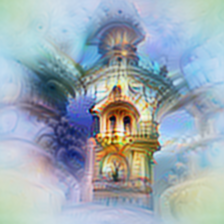</a> |  | <a href="assets/mixed4c_477/diversity.png">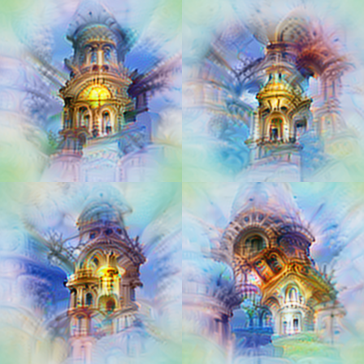</a> | <a href="assets/mixed4c_477/negative.png">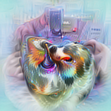</a> | <a href="assets/mixed4c_477/path_negative.png">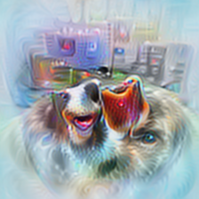</a> |

477 Diversity: the lower-left member has near-zero final post-ReLU activation.

## mixed4c · 260

| | Positive | Path-guided + | Diversity | Negative | Path-guided − |
|---|---|---|---|---|---|
| AlreadyClean |  |  |  |  |  |
| Neuron Microscope | <a href="assets/mixed4c_260/positive.png">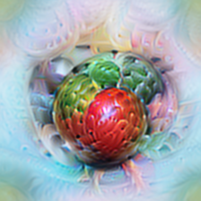</a> | <a href="assets/mixed4c_260/path_positive.png">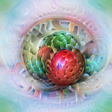</a> | <a href="assets/mixed4c_260/diversity.png">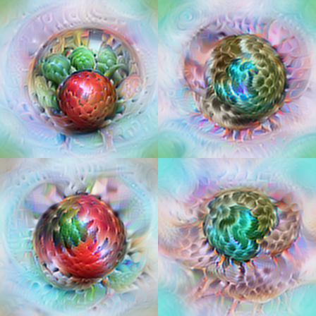</a> | <a href="assets/mixed4c_260/negative.png">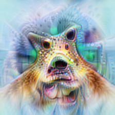</a> | <a href="assets/mixed4c_260/path_negative.png">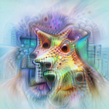</a> |

## mixed4c · 286

| | Positive | Path-guided + | Diversity | Negative | Path-guided − |
|---|---|---|---|---|---|
| AlreadyClean |  |  |  |  |  |
| Neuron Microscope | <a href="assets/mixed4c_286/positive.png">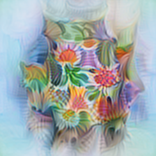</a> | <a href="assets/mixed4c_286/path_positive.png">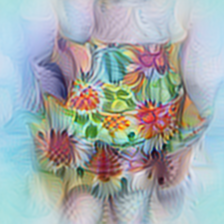</a> | <a href="assets/mixed4c_286/diversity.png">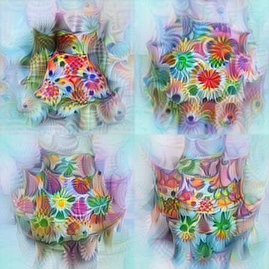</a> | <a href="assets/mixed4c_286/negative.png">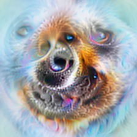</a> | <a href="assets/mixed4c_286/path_negative.png">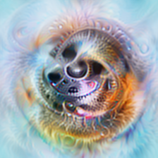</a> |

## mixed4c · 212

| | Positive | Path-guided + | Diversity | Negative | Path-guided − |
|---|---|---|---|---|---|
| AlreadyClean |  |  |  |  |  |
| Neuron Microscope | <a href="assets/mixed4c_212/positive.png">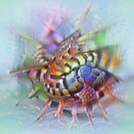</a> | <a href="assets/mixed4c_212/path_positive.png">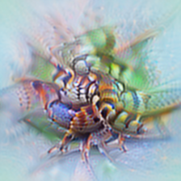</a> | <a href="assets/mixed4c_212/diversity.png">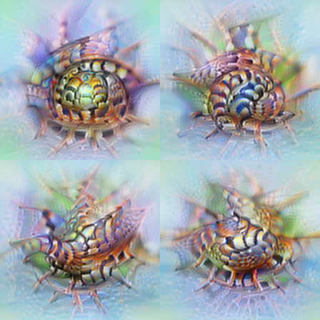</a> | <a href="assets/mixed4c_212/negative.png">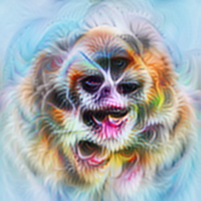</a> | <a href="assets/mixed4c_212/path_negative.png">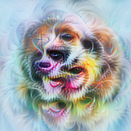</a> |

[Image settings and measured scores](assets/provenance.json) · [Original microscope](https://already-clean.goodfire.com/microscope/inceptionv1.html?layer=mixed4c&neuron=477)
